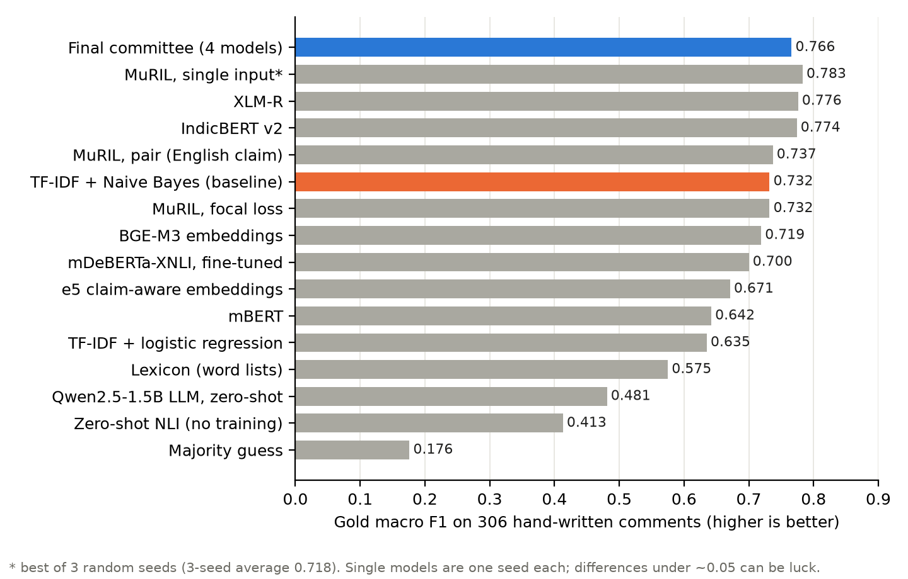
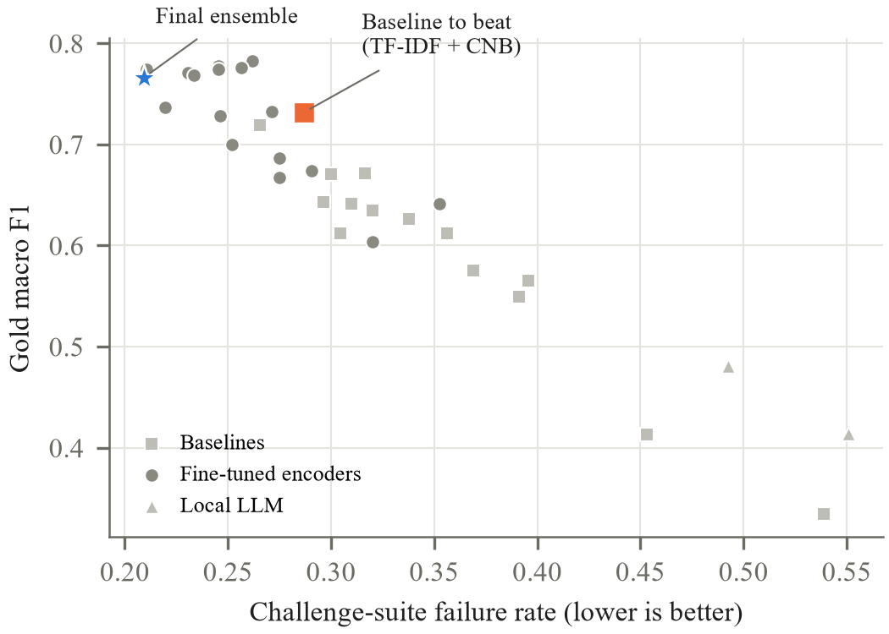
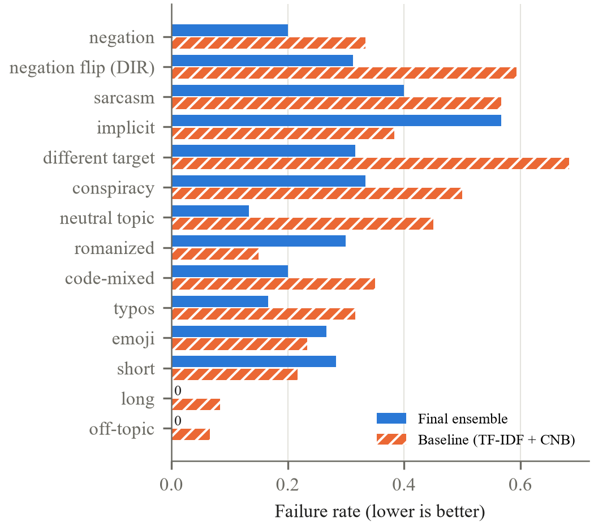

# The whole project, explained simply

This is the informal version. No jargon without an explanation, and a reason for every step.
Technical terms are listed at the bottom in a small glossary.

---

## 1. What problem are we solving?

The challenge gives us one fixed statement:

> **"Climate change and global warming is a serious concern."**

For any comment written in **Hindi** or **Bengali**, the computer must decide what the writer thinks about that statement:

| Label | Meaning | Example |
|---|---|---|
| **Favour** | agrees that climate change is serious | "जलवायु परिवर्तन एक गंभीर समस्या है" (climate change is a serious problem) |
| **Against** | disagrees or denies it | "ग्लोबल वार्मिंग सब झूठ है" (global warming is all a lie) |
| **None** | no opinion either way, or off-topic | "कल दिल्ली में बारिश होगी" (it will rain in Delhi tomorrow) |

This is called **stance detection**: not "is the comment happy or angry?" but "which side is it on?"
Those are different. An angry comment can still be on the Favour side, for example angry *at* people who deny climate change.

The score is **macro F1**. Think of it as an accuracy score that weights all three labels equally. A model can't
score well by always guessing the most common label. 1.0 is perfect; random guessing gets about 0.33.

### Why it's hard

Real comments on YouTube or Facebook are messy:

- **Romanized**: Hindi written in English letters ("climate change bahut serious hai").
- **Code-mixed**: half Hindi, half English in one sentence.
- **Typos, emoji, slang**, very short ("सब ढोंग है", "all a sham") or very long.
- **Sarcasm**: "हाँ हाँ, धरती गर्म हो रही है, इसलिए दिसंबर में बर्फ पड़ रही है 🙄" ("yeah yeah, the earth is warming, that's why it's snowing in December") is *Against* even though it literally says the earth is warming.
- **Negation**: "it's wrong to say climate change is a lie" is *Favour*, even though it contains the word "lie".

### Our three handicaps

1. **No training data.** The challenge gives no labelled Hindi or Bengali examples. Normally you learn from thousands of examples. We had zero.
2. **A small computer.** A laptop with a 4 GB graphics card. Big AI models need 16–80 GB.
3. **No paid AI services and no internet uploads.** Everything had to run locally with free, open models.

---

## 2. The big picture (one paragraph)

We **built our own training data** by translating English climate-opinion datasets into Hindi and Bengali and making
messy versions of them. We **built our own exams** (hand-written test comments and a set of trick questions) that look
like the real hidden test. Then we **trained many different models**, from very simple word-counting ones to large
language models, and compared them fairly. We **combined the best four into a team** (an ensemble), which became the
final model. Finally we **explained** where it fails and **packaged** everything: a prediction script, a demo app,
reports and a presentation.

```
English datasets ─► translate ─► make messy copies ─► clean & split ─► TRAINING DATA
                                                                         │
             hand-written exam + trick questions (never trained on) ─────┤
                                                                         ▼
     simple models · embedding models · big transformer models · small local LLM
                                                                         │
                                       pick & combine the best (ensemble) ▼
                                                                    FINAL MODEL
```

---

## 3. Step 1: Building the training data (Phase 1)

**Why:** a model learns from labelled examples, and we had none in Hindi or Bengali. So we had to make them.

**Where the raw material came from.** Four public datasets that already have opinions labelled:

| Dataset | Language | What it is |
|---|---|---|
| SemEval-2016 Task 6 (climate part) | English | tweets about "climate change is a real concern" |
| GWSD | English | news sentences labelled against *exactly our statement* |
| ClimateStance | English | climate tweets from 2019 |
| Dhoroni | Bengali | Bengali environmental news headlines |

We converted each dataset's labels to our three labels. Example of a careful decision: Dhoroni's "Negative" means *bad
environmental news*, not *denial*, so we did **not** turn it into "Against". That would have taught the model nonsense.

**How we made it Hindi and Bengali:**

1. **Translation.** We used **NLLB-200**, a free translation model from Meta, to translate the English sentences into
   Hindi and Bengali. We wanted IndicTrans2 (better for Indian languages), but it needs special access, so we used
   NLLB and left IndicTrans2 ready to switch on later.
2. **Quality check by translating back.** Each Hindi or Bengali sentence was translated *back* to English, and we compared it
   with the original using **LaBSE**, a model that measures whether two sentences mean the same thing. If the meaning
   drifted too far (similarity below 0.75), we threw the translation away. 93 % passed.
3. **Romanized copies.** A rule-based converter rewrote Hindi and Bengali script into English letters, the way people actually
   type ("parivartan", "bahut", with the casual spelling variation people use).
4. **Code-mixed copies.** Some Hindi or Bengali words were swapped for English ones ("climate", "serious", "problem") to imitate
   Hinglish and Banglish.
5. **Templates.** We hand-wrote sentence patterns for each label in 10 styles (formal, slang, sarcastic, emoji, short,
   long and so on). The rule was that these could be at most 40 % of the data; they ended up as only 8.9 %.
6. **Removing duplicates and preventing cheating.**
   - Near-identical sentences were removed with a technique called MinHash.
   - A sentence and all its copies (translation, Romanized, code-mixed) were kept in the *same* split. Otherwise the model
     could see the Hindi version in training and "recognise" the Romanized version at test time, which is cheating
     and gives fake-good scores.
   - We also removed anything too similar to our exam questions.

**Result:** 19,278 training rows and 1,402 validation (dev) rows, roughly half Hindi and half Bengali.

**Bugs we caught on the way:** the Romanizer leaked strange characters ("rikaॉrd"), and the code-mixer swapped words
*inside* other words ("peopleों"). We fixed both and rebuilt the whole dataset (version 2).

---

## 4. Step 2: Making our own exams (Phase 1 and Phase 7)

**Why:** this is the most important idea in the project. Our training data is *translated news and tweets*. The real test
is *messy comments*. If we only test on more translated data, we are practising for the wrong exam. A model can look
great in practice and still fail the real thing.

So we built two exams that look like the real test and **never trained on them**:

1. **Gold set: 306 hand-written comments.** 153 Hindi and 153 Bengali, written *before* any model was trained,
   covering 14 kinds of comment: explicit, implicit, negation, sarcasm, Romanized, code-mixed, typos, emoji, short, long,
   neutral-but-on-topic (weather news), off-topic, conspiracy theories, and comments about a different target.
2. **Challenge suite: 1,084 trick questions**, in the style of "CheckList":
   - 780 basic skill tests per category ("can it handle sarcasm?").
   - 240 "this should NOT change the answer" tests: add a typo, an emoji, a URL or a username, and the label must stay the same.
   - 64 "this SHOULD flip the answer" tests: add "not" and the label must change.

We report a **failure rate**: the share of trick questions the model gets wrong (lower is better).

**Rule we followed strictly:** all learning and tuning used only training data and the dev set. The two exams were used
only to *compare* finished models.

---

## 5. Step 3: Looking at the data first (Phase 2, EDA)

**Why:** before building models, look at what you have. This changed several decisions.

What we found:

- **Against is rare**: only 11.5 % of training rows. Models would be tempted to never say Against, so we used class weights (Section 7).
- **Translated text is about twice as long** as real comments (median 107 vs 62 characters).
- **About 15 % of translated rows have questionable labels.** We checked 50 by hand: spam tweets labelled Favour, sarcasm labelled Favour, and so on. We inherit this "label noise" from the sources.
- **Template sentences are too easy.** Models score 94–99 % on them, so they inflate practice scores.

Charts are in `results/figures/` and the notebook is `notebooks/eda.ipynb`.

---

## 6. Step 4: Simple models first (Phase 3, baselines)

**Why:** always start with simple methods. If a fancy model can't beat a simple one, the fancy one isn't worth it.
These simple models are called **baselines**.

| Type | How it works (simply) |
|---|---|
| Majority / random | always guess the most common label, or guess randomly. The "floor" score. |
| Lexicon | a hand-written list of words ("झूठ" means lie, so Against; "गंभीर" means serious, so Favour) plus negation rules |
| **TF-IDF + classifier** | counts which words and letter-chunks appear and learns which ones point to which label. Fast, old and surprisingly strong. |
| Embeddings + classifier | a pre-trained model turns each sentence into a list of numbers that capture its meaning; a simple classifier learns from those numbers |
| Zero-shot NLI | asks a ready-made "does sentence A imply sentence B?" model with no training at all |
| Stacking | combines the best simple models |

We tested them with **5-fold cross-validation (CV)**: split the training data into 5 parts, train on 4, test on the 5th, rotate, and average.

**Results (gold F1, higher is better; fail rate, lower is better):**

| Model | Gold F1 | Fail rate |
|---|---|---|
| **TF-IDF + Complement Naive Bayes** | **0.732** | 0.287 |
| BGE-M3 embeddings | 0.719 | 0.266 |
| TF-IDF + logistic regression | 0.635 | 0.320 |
| Zero-shot NLI | 0.413 | 0.453 |
| Majority guess | 0.176 | 0.542 |

So **TF-IDF + Naive Bayes became the "baseline to beat."**

**First big lesson:** practice scores (CV) and exam scores (gold) **disagree**. One model had the *best* CV score (0.675)
and one of the *worst* gold scores (0.550). Practice on translated data does not predict the real exam. That's why we
built our own exams.

---

## 7. Step 5: Big models (Phase 4, transformers)

**What a transformer is:** a large neural network such as BERT that has already read huge amounts of text, so it already
"understands" language. **Fine-tuning** means giving it our labelled examples so it learns our specific task. It's like
hiring someone fluent in Hindi and training them for one job, instead of teaching a baby the language from scratch.

**Which ones we tried:**

- **MuRIL** (Google): trained on Indian languages, *including Romanized text*, so our first choice.
- **IndicBERT v2**: Indian languages.
- **XLM-R** and **mBERT**: general multilingual models.
- **BanglaBERT**: Bengali only.
- **mDeBERTa-XNLI**: a "does A imply B?" model, fine-tuned.

**Our key idea: "pair input".** Normally the model only sees the comment. We also tried showing it the statement *and* the comment together:

```
single:  [comment]
pair:    [Climate change is a serious concern] [SEP] [comment]
```

It's like telling a person "here's the claim, now read this comment: do they agree?" We also tested *which language the
claim should be in*: English, Hindi, Bengali, or the same language as the comment.

**The 4 GB problem.** MuRIL has a vocabulary of 197,000 words, and storing all of that while training didn't fit in 4 GB.
Windows silently overflowed into normal RAM and training crawled at 8 seconds per step (8 hours per run). The fix was to
**freeze the vocabulary layer**: keep it fixed, and train everything else. That brought it down to 0.25 seconds per step,
about 15 minutes per run.

**Results (one random seed):**

| Model | Gold F1 | Fail rate |
|---|---|---|
| MuRIL, single input | 0.783 | 0.262 |
| MuRIL, pair (Bengali claim) | 0.777 | 0.245 |
| XLM-R | 0.776 | 0.256 |
| IndicBERT v2 | 0.774 | **0.210** |
| MuRIL, pair (English claim) | 0.737 | 0.220 |
| mBERT | 0.642 | 0.352 |

**The biggest surprise: luck matters a lot.** Training involves randomness, controlled by a number called the **seed**.
We trained the same MuRIL setup 3 times with 3 seeds and got gold F1 **0.783, 0.604 and 0.768**. Same model, same data,
very different scores. So the small differences between MuRIL, XLM-R and IndicBERT are just luck. Nobody "won".

One run (seed 44, Bengali claim) **never learned at all**. It kept guessing the most common label for all 3 rounds.
This is a known problem with BERT-style models. We detect such runs using only the dev set and report them separately.

**What the 3 seeds showed about pair input:** averaged over seeds, pair input was **as accurate as single input, more
robust, and much more stable**. So the idea helps, just not dramatically.

---

## 8. Step 6: A small local LLM (Phase 5)

We tried **Qwen2.5-1.5B**, a small ChatGPT-style model that fits on the laptop. We didn't let it write free text (which
can be messy to read back). We measured how likely it thought each label word was and picked the highest.

- Without examples: gold F1 **0.481**.
- With 4 similar examples shown in the prompt: **0.414**, and 27× slower, because the longer prompt overflowed the 4 GB card.

**Lesson:** a small chat model is much worse than a fine-tuned specialist. It almost never said Against. Bigger LLMs might
do better, but they don't fit this hardware.

---

## 9. Step 7: Data tricks (Phase 6, augmentation ablations)

**Idea:** maybe adding or removing kinds of data helps. We tested 11 changes, one at a time:
remove templates, remove Romanized, remove code-mixed, add typos, add dropped vowel signs, add repeated letters, add
"not"-flipped sentences, add paraphrases, add the original English data, add 3× more templates.

**Rule (decided in advance):** keep a change only if *both* the practice score *and* the trick-question failure rate improve.

**What happened:**

- 5 changes technically passed the rule, but every improvement was **smaller than the random-luck noise** we measured. So we kept none of them. Adopting noise would just be fooling ourselves.
- One clear result: **removing the templates collapsed the scores** (0.732 down to 0.419). The short, comment-like templates matter a lot. Caveat: the templates and the gold exam were written by the same author, so some of that may be shared writing style.
- Automatically flipping sentences with "not" mostly produced wrong sentences: only 14 of 64 were correct when checked by hand. So we kept just those 14.

---

## 10. Step 8: The final model (Phase 8)

**Ensemble = a committee.** Instead of trusting one model, we average the opinions of several different ones. Their
mistakes are different, so averaging cancels some out and smooths over unlucky seeds.

**The final committee (4 members):**

1. MuRIL, pair input, English claim.
2. MuRIL, pair input, focal loss (a training variant that focuses on hard examples).
3. TF-IDF + Naive Bayes (the old-school word counter).
4. BGE-M3 embeddings + classifier.

**How we chose it.** We tried 11 candidate combinations (single models, simple average, weighted average, stacking, each with and without
"calibration") and ranked them with one fixed formula:

```
score = gold F1 − 0.5 × challenge failure rate
```

This rewards accuracy *and* punishes failing trick questions, because the real test is messy. Every candidate's score
is published in `results/final_candidates.csv`, so nothing is hidden.

**Calibration** adjusts how confident the model claims to be, so that "80 % sure" really means right about 80 % of the time.
It made confidence more honest on dev but slightly lowered gold accuracy, so the final model doesn't use it.

### Final results

| | Gold F1 | Hindi | Bengali | Fail rate |
|---|---|---|---|---|
| **Final committee** | **0.766** | 0.800 | 0.732 | **0.209** |
| Baseline to beat | 0.732 | 0.727 | 0.738 | 0.287 |

**Is 0.766 really better than 0.732?** We checked with a **bootstrap test**: re-sample the 306 exam questions thousands of
times and see how much the difference wobbles. The difference ranges from about −0.02 to +0.09, which includes zero.
So, honestly, **the accuracy gain is not proven.**

**But the robustness gain is real.** It fails 21 % of trick questions against 29 %, with big improvements on:

- negation-flip tests: 59 % → 31 %
- comments about a different target: 68 % → 32 %
- neutral weather and news text: 45 % → 13 %

---

## 11. Step 9: Making it fast on a normal computer

The committee is big (1.9 GB) and takes about 0.2 seconds per comment on a CPU. For a lighter option we **quantised**
MuRIL: stored its numbers in 8-bit instead of 32-bit to make it smaller and faster.

**A bug story.** The first quantisation destroyed the model (0.74 dropped to 0.33). The investigation found that some
internal layers produce occasional huge numbers ("outliers") that 8-bit storage can't represent. Quantising only the
"attention" layers fixed it: almost identical answers, 14 ms per comment. This is the "efficient" model.

| Option | Gold F1 | Speed on CPU |
|---|---|---|
| TF-IDF + Naive Bayes | 0.732 | 0.2 ms |
| MuRIL, 8-bit (efficient) | 0.715 | 14 ms |
| MuRIL, full precision | 0.737 | 17 ms |
| Final committee | 0.766 | 197 ms |

---

## 12. Step 10: Why does it make mistakes? (Phase 9)

We used two explanation tools that highlight which words pushed the decision:

- **Integrated Gradients**: looks inside the transformer.
- **LIME**: changes the sentence slightly many times and watches how the answer moves.

Example HTML explanations are in `results/explanations/index.html`.

**Main mistakes:**

1. **Negated denial.** "ये कहना गलत है कि जलवायु परिवर्तन एक झूठ है" means "it's wrong to say climate change is a lie" (Favour).
   The model says **Against**. LIME shows that the word "झूठ" (lie) dominates, and "गलत" (wrong) doesn't push back. The model
   learned "lie means Against" but not "saying it's wrong to call it a lie means Favour."
2. **Implicit comments** (43 % correct). "Children won't even get air fit to breathe if we don't change" (T016 in your test
   file) never says "climate change is serious" directly, so it got labelled None. The English training data states opinions too directly.
3. **Sarcasm** (70 % correct). Hard for every model.

Your own test file showed the same pattern: about 11 of 77 looked wrong, almost all negation, sarcasm or implicit.

---

## 13. Every model we used: what it is, why we chose it, and how it performed

This section goes through **all** the models one by one. For each: what it is in plain words, why it was in the
project, and its scores.

**How to read the scores:**

- **Gold F1**: score on our 306 hand-written exam comments (0 to 1, higher is better). This is the main number.
- **Hindi / Bengali**: the same score on just the Hindi or just the Bengali half.
- **Fail rate**: share of the 1,084 trick questions answered wrong (lower is better).
- With only 306 exam comments, differences smaller than about **0.05** can be luck.



*Figure A: gold F1 for the main models (one seed each, except where noted). Blue is the final committee; orange is the baseline to beat.*

**Why isn't the committee the top bar?** A few single models scored slightly higher *with one lucky seed*. Their
averages over several seeds are lower (MuRIL single input averages 0.718 over 3 seeds), and the differences at the top
are within the ±0.05 luck range. The committee was chosen for accuracy **and** robustness, and it has the lowest
trick-question failure rate of all (Figure B).

### 13.1 Helper models (not classifiers, but the project depends on them)

| Model | What it is | Why we used it | How it did |
|---|---|---|---|
| **NLLB-200 (distilled, 600M)** by Meta | free translation model covering 200 languages | to translate the English training data into Hindi and Bengali; the better Indian option (IndicTrans2) needs special access | 93 % of its translations passed our quality check (Hindi 95 %, Bengali 91 %) |
| **LaBSE** by Google | turns sentences in 109 languages into "meaning numbers" | to check translation quality: if the back-translated English no longer means the same thing, the translation is discarded. Also used as a classifier input (below) and to find similar examples for the LLM | worked reliably as a filter (average similarity 0.91) |

### 13.2 Floor models (to know what "bad" looks like)

| Model | What it is | Gold F1 | Fail | Verdict |
|---|---|---|---|---|
| Majority | always answers the most common label | 0.176 | 0.542 | the absolute floor |
| Random | guesses in proportion to label frequency | 0.334 | 0.539 | what pure luck gets |
| Lexicon | hand-written word lists ("झूठ" means lie, so Against) plus negation rules | 0.575 | 0.369 | better than luck but brittle; its gold score is flattering because the same person wrote the lexicon and the exam |

### 13.3 Word-counting models (TF-IDF family)

**What they are:** count which words and 2–5-letter chunks appear in a comment, give distinctive ones more weight, and
learn which counts point to which label. Letter chunks help with typos and Romanized spelling ("bahut", "bahot").
**Why:** fast (under 1 ms per comment), cheap, and often surprisingly strong. Every project needs this as the bar to beat.

| Model | Gold F1 | Hindi | Bengali | Fail | Verdict |
|---|---|---|---|---|---|
| **TF-IDF + Complement Naive Bayes** | **0.732** | 0.727 | 0.738 | 0.287 | **the baseline to beat**: best simple model and very fast; part of the final committee |
| TF-IDF + logistic regression | 0.635 | 0.664 | 0.606 | 0.320 | best practice (CV) score among the plain versions, but weaker on the exam |
| TF-IDF + SVM | 0.627 | 0.594 | 0.659 | 0.338 | similar |
| NB-SVM | 0.612 | 0.656 | 0.568 | 0.356 | a classic text-classification trick; did not help here |
| TF-IDF + LR with Romanized copy | 0.550 | 0.679 | **0.396** | 0.391 | **best practice score of all (0.675) but among the worst exam scores**, a warning that practice scores mislead |

**Why did Naive Bayes win?** Complement Naive Bayes copes well with uneven label counts and short texts. Our exam
comments are short and balanced, unlike the long translated training text.

### 13.4 Meaning-based models (embeddings + a simple classifier)

**What they are:** a pre-trained model turns each comment into a list of numbers that captures its meaning; a simple
classifier (logistic regression) learns from those numbers. The big model itself is not retrained.
**Why:** they understand meaning across languages and spellings, not just exact words. The "claim-aware" versions also
compare the comment's meaning with the claim's meaning, our "pair" idea in a cheap form.

| Model | Gold F1 | Hindi | Bengali | Fail | Verdict |
|---|---|---|---|---|---|
| **BGE-M3 + LR** | **0.719** | 0.722 | 0.716 | **0.266** | best of this group and more robust than TF-IDF; part of the final committee. Slowest (~350 ms per comment on CPU) |
| e5-base, claim-aware | 0.671 | 0.682 | 0.661 | 0.316 | claim-awareness added +0.03 over plain e5 |
| e5-base + LR | 0.641 | 0.648 | 0.634 | 0.310 | |
| LaBSE, claim-aware | 0.643 | 0.637 | 0.649 | 0.296 | claim-awareness added +0.03 over plain LaBSE |
| LaBSE + LR | 0.612 | 0.590 | 0.635 | 0.304 | good at "same meaning?" but less good at opinions |
| Stacked (TF-IDF translit + e5) | 0.670 | 0.715 | 0.625 | 0.300 | combined the two best *practice-score* models; it inherited the weakness of one of them |

### 13.5 Zero-shot "does A imply B?" model

| Model | What it is | Gold F1 | Fail | Verdict |
|---|---|---|---|---|
| mDeBERTa-v3 XNLI (no training) | a model trained to judge whether one sentence implies another; we asked "does this comment imply climate change is serious?" | 0.413 | 0.453 | **poor**: logic-style "implies" does not match opinions in Hindi and Bengali comments without training. Fine-tuned on our data it reaches 0.700 (below) |

### 13.6 Fine-tuned transformers (the big models)

**What they are:** large neural networks that have already read huge amounts of text. We **fine-tune** them: train them
further on our labelled data so they learn this task. Each took 11–62 minutes to train on the laptop.
**Why several:** different models were trained on different languages and data, and we wanted to know which suits
Hindi and Bengali social media best.

| Model | Why it was a candidate | Gold F1 | Hindi | Bengali | Fail | Verdict |
|---|---|---|---|---|---|---|
| **MuRIL** (Google) | built for Indian languages *and* trained on Romanized text, a natural fit for Hinglish/Banglish | 0.783 (single input, seed 42); 0.718 ± 0.099 over 3 seeds | 0.822 | 0.744 | 0.262 | top-tier, but **very sensitive to the random seed**. Two MuRIL versions are in the final committee |
| MuRIL, pair input, English claim | our "show it the claim" idea | 0.737; 0.726 ± 0.054 over 3 seeds | 0.769 | 0.704 | 0.220 | more robust and stable than single input; **in the final committee** |
| MuRIL, pair input, Bengali claim | same idea, claim in Bengali | 0.777; 0.774 ± 0.005 over 2 good seeds | 0.777 | 0.778 | 0.245 | best average, but one of its 3 seeds failed to train at all |
| MuRIL, pair input, focal loss | a training variant that focuses on hard examples | 0.732 | 0.736 | 0.729 | 0.271 | **in the final committee** (second-best on dev) |
| **IndicBERT v2** (AI4Bharat) | trained on 24 Indian languages | 0.774 | 0.779 | 0.769 | **0.210** | as good as MuRIL and the **most robust single transformer** |
| **XLM-R base** (Meta) | strong general model for 100 languages | 0.776 | 0.803 | 0.749 | 0.256 | as good as MuRIL |
| mDeBERTa-XNLI, fine-tuned | the zero-shot model above, now trained on our data | 0.700 | 0.714 | 0.685 | 0.252 | big jump from 0.413, but below the others and the slowest to train (62 min) |
| mBERT (Google) | the original multilingual BERT, the reference point | 0.642 | 0.639 | 0.644 | 0.352 | **clearly the weakest**: older and not specialised for Indian languages |
| BanglaBERT | specialised for Bengali only | 0.797 (Bengali half only) | – | 0.797 | 0.201 | best on Bengali, but **cannot read Hindi**, so it can't be the main model; its score isn't comparable with the two-language ones |

**What we learned:**

- MuRIL, XLM-R and IndicBERT v2 are **tied**: the difference between them (0.774–0.783) is smaller than the
  difference between two random seeds of the same model (0.604–0.783).
- **Pair input** (showing the claim) gave similar accuracy with fewer trick-question failures and much less variation between seeds.
- Which language the claim is in matters a little: a fixed English or Bengali claim worked better than switching to the
  comment's language.

### 13.7 Small local LLM

| Model | What it is | Gold F1 | Fail | Speed | Verdict |
|---|---|---|---|---|---|
| **Qwen2.5-1.5B-Instruct**, no examples | a small ChatGPT-style model that fits on the laptop; we read off which label word it found most likely | 0.481 | 0.493 | 0.36 s per comment (GPU) | **poor**: almost never says Against |
| Same, with 4 similar examples in the prompt | normally this helps | 0.414 | 0.551 | 9.7 s per comment | **worse and 27× slower**: the long prompt didn't fit in 4 GB |

**Why it was weak:** it's small (1.5 billion parameters), it isn't trained on our task, and it isn't strong in Hindi
and Bengali. A specialist fine-tuned model of a few hundred million parameters easily beats a small general chat model.

### 13.8 The final committee (ensemble)

| Member | Brings |
|---|---|
| MuRIL, pair input, English claim | deep language understanding, robust |
| MuRIL, pair input, focal loss | a second "opinion" from a differently trained MuRIL |
| TF-IDF + Complement Naive Bayes | sharp word-level cues; very different mistakes from the transformers |
| BGE-M3 + LR | meaning-level understanding from a different model family |

**How it decides:** each member gives a probability for Favour, Against and None; we average the four and pick the highest.

| | Gold F1 | Hindi | Bengali | Fail | CPU time |
|---|---|---|---|---|---|
| **Final committee** | **0.766** | **0.800** | 0.732 | **0.209** | 197 ms |
| Best single member (MuRIL pair-en) | 0.737 | 0.769 | 0.704 | 0.220 | 17 ms |
| Baseline to beat (TF-IDF + NB) | 0.732 | 0.727 | 0.738 | 0.287 | 0.2 ms |

**Per label** on the exam:

| Label | Precision (when it says X, how often right) | Recall (of the real X, how many found) | F1 |
|---|---|---|---|
| Favour | 0.84 | **0.57** | 0.68 |
| Against | 0.80 | 0.90 | 0.85 |
| None | 0.70 | 0.86 | 0.77 |

So it is **very good at catching Against** (90 %) and careful when it says Favour, but it **misses many Favour comments**
(57 % found). Those mostly get called Against (negated denials, sarcasm) or None (implicit opinions).



*Figure B: every model's exam score (up is better) against its trick-question failure rate (left is better). The final committee sits top-left: accurate and the most robust.*



*Figure C: where the final committee (blue) fails fewer trick questions than the baseline (orange). Big wins on negation, different target, conspiracy and neutral text; it is worse on implicit, Romanized, emoji and short comments.*

### 13.9 The fast version

| Model | Gold F1 | Fail | CPU time | Use it when |
|---|---|---|---|---|
| MuRIL pair-en, 8-bit (attention layers) | 0.715 | 0.223 | 14 ms | you need speed on a normal computer and can accept slightly lower accuracy |
| TF-IDF + Naive Bayes | 0.732 | 0.287 | 0.2 ms | you need extreme speed or a tiny model (19 MB) |

### 13.10 One-line summary per model

- **TF-IDF + Naive Bayes:** simple, fast, surprisingly strong; the bar to beat.
- **BGE-M3:** best of the frozen meaning models; robust but slow.
- **MuRIL / XLM-R / IndicBERT v2:** the strongest, effectively tied; results swing with luck.
- **mBERT:** outdated for this task.
- **BanglaBERT:** great for Bengali, unusable for Hindi.
- **Zero-shot NLI and the small LLM:** not good enough without real training.
- **Final committee:** best overall, especially on trick questions; the accuracy gain over TF-IDF isn't statistically proven, but the robustness gain is clear.

---

## 14. What we delivered (Phase 10 and 11)

| What | Where | What it does |
|---|---|---|
| Prediction script | `scripts/predict.py` | give it a CSV of comments and it writes labels and probabilities |
| Demo app | `app.py` | a web page (Gradio): type a comment, see the label and the highlighted words |
| One-command rebuild | `run_all.ps1` | rebuilds everything from scratch; `-Quick` does a 10–20 min check (tested in a clean copy) |
| Upload script | `scripts/upload_to_hf.py` | run it after `huggingface-cli login` to publish the model to Hugging Face |
| Model card and datasheet | `models/MODEL_CARD.md`, `docs/datasheet.md` | standard documentation of the model and data |
| Reports | `reports/` | technical report (Markdown, Word, IEEE PDF), discussion, literature review, presentation outline, demo script, judge Q&A |
| All numbers | `results/tables.md`, `results/*.csv` | every result, plus `results/experiments.csv` logging every run with its git commit |
| Decisions log | `ASSUMPTIONS.md` | 19 decisions, each with the reason |
| Diary | `PROGRESS.md` | what happened in each session |

**How to label new comments yourself:**

```powershell
.venv\Scripts\python.exe scripts\predict.py --input my_comments.csv --output my_results.csv --model final
```

The input needs columns `id,text`. That's how `test_text_only_result.csv` was made.

---

## 15. Things that went wrong, and how they were fixed

Being honest about problems is part of good research. The main ones:

| Problem | Fix |
|---|---|
| IndicTrans2 needs special access | switched to NLLB; IndicTrans2 still wired in for later |
| The label "None" was read as "missing value" by pandas | a custom loader keeps it as text |
| Romanizer and code-mixer bugs | fixed and rebuilt the dataset |
| MuRIL didn't fit in 4 GB (8 s per step) | froze the vocabulary layer (0.25 s per step) |
| Two GPU jobs at once starved each other | ran one GPU job at a time, in a queue |
| A memory-hungry baseline ran for 5 hours | removed its nested tuning |
| Long jobs died when the terminal that started them closed | started them as detached background jobs with a queue |
| Laptop went to sleep overnight | a small "keep awake" helper while jobs run |
| Automatic "not"-flipping mostly wrong | hand-checked, kept 14 of 64 |
| BanglaBERT (Bengali-only) nearly got picked for the final model | selection now requires both languages |
| A crash in the simple models' prediction function | fixed the code and re-ran the affected steps |
| 8-bit model collapsed | quantise only the attention layers |
| Model code wasn't being saved to git (an ignore rule was too broad) | fixed the ignore rule and committed the code |
| `run_all.ps1` died silently when its output went to a file | judge steps by exit code; verified in a clean copy |
| Two wrong citations in the literature review | corrected |

---

## 16. The key lessons (what to tell people)

1. **When you have no real data, build your own realistic exam and never train on it.** Practice scores on translated
   data were misleading.
2. **Random luck (the seed) mattered more than which model we picked.** Always run several seeds before claiming one model is better.
3. **Showing the model the claim (pair input) helps stability and robustness.**
4. **A committee of different models beats any single one on robustness.**
5. **Be honest about significance:** the accuracy gain isn't proven; the robustness gain is.
6. **The remaining weak spots are negation, sarcasm and implicit opinions.** Fixing them needs real, hand-labelled comments.

### 30-second pitch

> "There was no Hindi or Bengali training data, so we translated English climate-stance datasets, filtered the
> translations for quality, and generated Romanized and code-mixed versions. We wrote our own realistic test set and
> 1,084 trick questions that we never trained on, and used them to pick the model. The final system is a committee of
> four models. It reaches 0.77 macro F1 on hand-written comments and fails 21 % of trick questions, compared with 29 %
> for the best simple model, all on a 4 GB laptop with free local models."

---

## 17. What's left, and what would improve it

**Still to do** (the steps are in `MANUAL_TASKS.md`):

1. Push the repo to GitHub.
2. `huggingface-cli login`, then `python scripts/upload_to_hf.py --dry_run`, then run it again without `--dry_run`.
3. In the IEEE report, fill in your affiliation, and decide whether to keep your email in it.

**What would help most next:**

1. Label a few hundred **real** comments. `scripts/collect_youtube.py` and `docs/annotation_guideline.md` are ready.
2. Hand-write training examples of negation and "it's wrong to say…" sentences.
3. Run more seeds and average them.
4. Get IndicTrans2 access for better translations.

---

## Glossary

| Term | Simple meaning |
|---|---|
| **Stance** | which side a text takes on a statement (for, against, neither) |
| **Macro F1** | a 0–1 score that treats all three labels equally; higher is better |
| **Precision / recall** | precision: of the comments labelled X, how many really are X. Recall: of the real X comments, how many were found |
| **Training / dev / test** | data to learn from / data to tune and check on / data only for the final exam |
| **Gold set** | our 306 hand-written exam comments |
| **Challenge suite** | our 1,084 trick questions; failure rate = share answered wrong |
| **Cross-validation (CV)** | split the training data into 5 parts and take turns testing on each, for a fair practice score |
| **Baseline** | a simple model used as the bar to beat |
| **TF-IDF** | counts words and letter-chunks, giving more weight to distinctive ones |
| **Naive Bayes / logistic regression / SVM** | classic, fast classifiers that learn from those counts |
| **Embedding** | a list of numbers representing a sentence's meaning |
| **Transformer / BERT** | a large pre-trained neural network that understands language |
| **Fine-tuning** | further training a pre-trained model on our task |
| **Pair input** | showing the model the claim and the comment together |
| **Seed** | the number that controls training randomness; different seeds give different results |
| **LLM** | large language model (ChatGPT-style); ours was a small local one |
| **Zero-shot / few-shot** | using a model with no examples / with a few examples in the prompt |
| **Augmentation** | creating extra training data by modifying existing data |
| **Ablation** | removing or adding one thing at a time to see its effect |
| **Ensemble** | averaging several models (a committee) |
| **Calibration** | making the model's confidence match how often it is actually right |
| **Bootstrap test** | re-sampling the test set many times to see whether a difference is real or luck |
| **Quantisation** | storing a model's numbers with fewer bits to make it smaller and faster |
| **Romanized / code-mixed** | Hindi or Bengali written in English letters / mixed with English words |
| **Label noise** | training examples with wrong labels |
| **Leakage** | when test information sneaks into training, giving fake-good scores |
| **LIME / Integrated Gradients** | tools that show which words drove a prediction |
