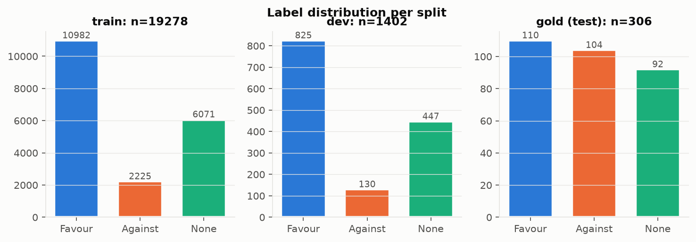
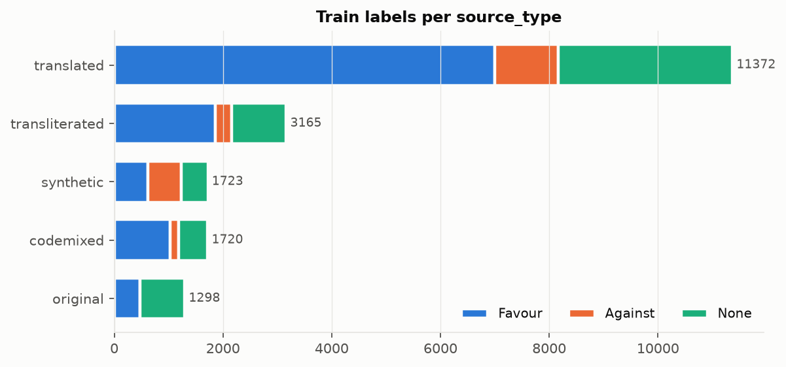
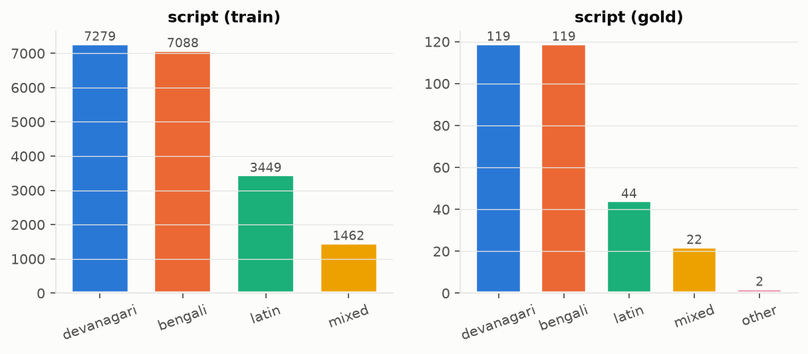
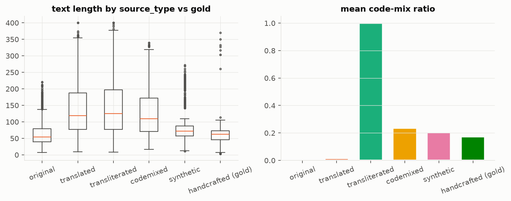
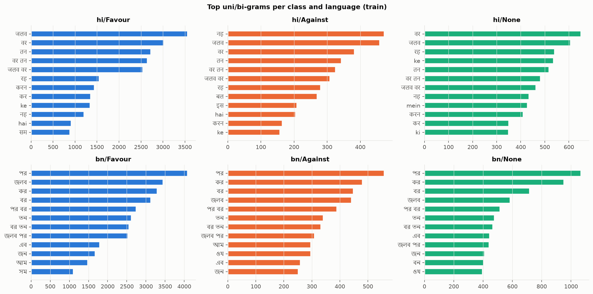
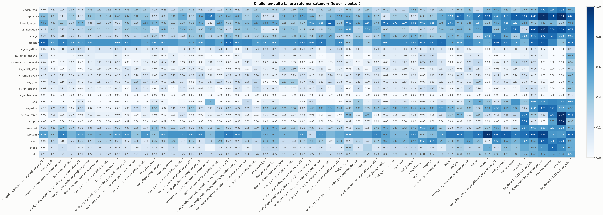
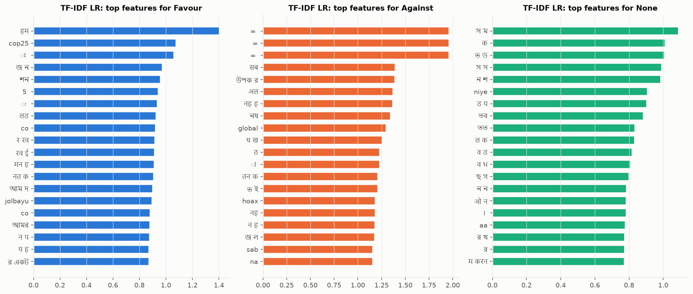
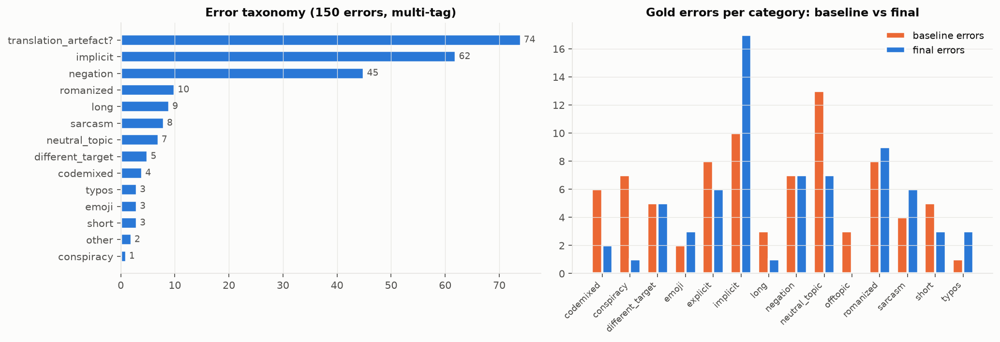

# Methodology

This section describes what was built and why. It contains design parameters only; every
measured number is in the results section, which is generated from `results/` by
`scripts/make_tables.py` and `scripts/write_report.py`.

## 1. Problem framing

Three-way stance classification of a Hindi or Bengali comment toward one fixed claim,
"Climate change and global warming is a serious concern" (Favour / Against / None), scored by
macro F1. The hidden test set is noisy: Romanized and code-mixed text, spelling variation,
sarcasm, negation, implicit stance and off-topic comments. Two consequences shaped every decision:

1. **There is no in-domain training data.** All training text is either translated from English
   stance datasets, Bengali news headlines, or generated. The training distribution therefore
   differs from the test distribution, and validation scores on translated text are a weak proxy
   for the hidden test.
2. **Robustness matters more than in-distribution accuracy.** We built two test-only resources that
   look like the hidden test: a hand-written gold set (306 comments, 14 phenomena) and a
   CheckList-style challenge suite (1,084 tests). Model selection uses them as the final arbiter,
   while all fitting (vectorisers, hyper-parameters, early stopping, calibration, stacking) uses
   training folds or the dev split only.

## 2. Data construction (Phase 1)

See `docs/datasheet.md` for full detail.

* **Sources.** SemEval-2016 Task 6 climate target, GWSD and ClimateStance (English); Dhoroni
  (Bengali news). Label mappings are justified in `src/stance/data/loaders.py`; Dhoroni's
  "Negative" (negative environmental news) is *not* mapped to Against.
* **Translation.** English -> Hindi and Bengali with NLLB-200-distilled-600M (IndicTrans2 is gated;
  the pipeline switches to it automatically when a Hub token exists). Each translation is
  back-translated and kept only if the LaBSE cosine between source and back-translation is at
  least 0.75. Bengali Dhoroni headlines are additionally translated to Hindi.
* **Social-media realism (train only).** A rule-based Romanizer (ITRANS plus Hindi schwa
  deletion, Bengali inherent-o, and random casual spelling variants) and a code-mixer (whole-word
  English substitution from a hand-written lexicon, English discourse markers, partial
  Romanization) create Hinglish/Banglish copies of training rows.
* **Template synthesis.** Hand-written Hindi and Bengali templates for each label and ten styles
  (formal, slang, sarcastic, implicit, negated, Romanized, code-mixed, emoji, short, long),
  capped at 40 % of training data. The compute tier allowed a 1.5B local LLM, but template
  generation was kept as the default so that every synthetic label is correct by construction;
  the LLM is used for classification and rationales instead (Phase 5).
* **Leakage control.** Exact and near-duplicate removal (MinHash over character 4-grams, Jaccard
  >= 0.85, within language) runs over all rows *including the gold set* before splitting. Splits are
  group-wise: a source sentence and all its translations and copies stay in one split. Train rows
  that near-duplicate any challenge test are removed.

## 3. Preprocessing (Phase 3)

Unicode NFC, Indic normalisation (indic-nlp-library), zero-width character removal, URL and
mention placeholders, hashtag text kept, elongation and punctuation-repeat reduction, Latin
lowercasing. Emoji are kept as tokens (an ablation flag allows demojising or removal), and a
flag transliterates Romanized text back to native script. **Negation words and stopwords are never
removed**: stance often flips on a single negator ("नहीं", "না", "nahi"), and transformers need
the full context.

## 4. Models

**Tier 1 reference points.** Majority class, stratified random, and a hand-built lexicon with
negation handling (Hindi, Bengali and Romanized cue lists). The lexicon was written by the same
author as the gold set, so its gold score is optimistic.

**Tier 2 sparse models.** TF-IDF word 1-2-grams plus char_wb 2-5-grams (sublinear tf), with Logistic
Regression, calibrated Linear SVM and Complement Naive Bayes; NB-SVM (Wang and Manning 2012);
and a transliterated-copy variant where every text is concatenated with its Romanized or native
copy, so both spellings share features. Class weights are balanced and hyper-parameters are chosen by
an inner 3-fold CV inside each outer fold.

**Tier 3 dense models.** Frozen LaBSE, multilingual-E5-base and BGE-M3 embeddings with Logistic
Regression; a target-aware variant using `[u, v, |u-v|, u*v]` features, where `v` is the claim
embedding in the comment's language; and zero-shot NLI with a multilingual mDeBERTa checkpoint,
with hypotheses written in Hindi and Bengali.

**Tier 4 hybrid.** Stacking of the best sparse and the best dense model on out-of-fold
probabilities with a Logistic Regression meta-learner.

**Transformers (Phase 4).** MuRIL (pre-trained on transliterated Indic text), IndicBERT v2, XLM-R
base, mBERT, BanglaBERT (Bengali only), and the fine-tuned multilingual NLI checkpoint. Two
input formulations:

* single: `[CLS] comment [SEP]`;
* **pair (target-aware, NLI-style): `[CLS] claim [SEP] comment [SEP]`**, with the claim in English,
  Hindi, Bengali, or the comment's own language. This tests whether stating the target explicitly
  helps, and in which language.

Training: weighted cross-entropy (inverse class frequency to the power 0.5) or focal loss,
AdamW, linear warm-up, fp16, max length 128, batch 16, early stopping on dev macro F1. On the
4 GB GPU the word-embedding matrix is frozen (MuRIL has a 197k vocabulary), which keeps the run in
VRAM (ASSUMPTIONS #12). Three seeds are run for the strongest configurations; one seed elsewhere.

**Local LLM (Phase 5).** Qwen2.5-1.5B-Instruct in fp16. Classification uses constrained scoring:
the log-likelihood of each label word after a stance-definition prompt, so output parsing cannot
fail. Few-shot examples are retrieved by LaBSE kNN from labelled training data. The LLM also
writes one-sentence rationales, an explainability aid that is not ground truth. QLoRA was not run
because it does not fit in 4 GB.

## 5. Augmentation ablations (Phase 6)

One change at a time against the current training set, on both the sparse baseline to beat (5-fold CV,
gold, challenge) and MuRIL (dev, gold, challenge): remove synthetic, Romanized or code-mixed
rows; add character noise, dropped vowel signs (matras), repeated characters, back-translation
paraphrases, hand-verified negation-flip contrast pairs, English source data (cross-lingual), or
three times more template data. An augmentation is **kept only if it improves both CV macro F1 and
the challenge-suite failure rate**. Negation flips: 64 automatic candidates were reviewed by hand
and only 14 were kept (ASSUMPTIONS #15), because in most of the others the rest of the comment still
argued the original side.

## 6. Robustness challenge suite (Phase 7)

Following CheckList (Ribeiro et al. 2020): minimum-functionality tests in 13 categories x 2
languages with at least 30 each (negation, sarcasm, implicit stance, Romanized, code-mixed, typos,
emoji cues, very short, very long, topic-related neutral, off-topic, conspiracy framing,
different target); invariance tests (typos, emoji, URLs, mentions, elongation, whitespace,
partial Romanization, punctuation must not change the label); and directional tests where negation
must flip the label. The suite is generated from hand-written seeds with templates that differ
from the training templates, and it is never used for fitting.

## 7. Ensembles, calibration and efficiency (Phase 8)

Candidates: the top transformers by dev F1, the best sparse and dense baselines, and the stacked
hybrid. Combination by equal averaging, dev-tuned weighted averaging, and stacking. Transformers have
no out-of-fold predictions on this hardware, so the meta-learner, temperature scaling and
per-class log-space biases (equivalent to per-class thresholds) are fitted on the **dev** split,
which was used only for early stopping. The final model is chosen by
`gold macro F1 - 0.5 x challenge failure rate`; every candidate's score is reported. An efficient
option is provided (dynamically quantised int8 transformer, or the hybrid sparse+dense model),
with a CPU accuracy-vs-cost table.

## 8. Explainability and error analysis (Phase 9)

Integrated Gradients (Captum, `[PAD]` baseline, claim segment masked from the display) and LIME for
the transformer; the largest TF-IDF coefficients per class for the sparse model; 10 correct and 10
wrong gold examples per language are rendered as HTML. Errors on gold and dev (more than 100) are tagged
with rule-based categories (sarcasm, implicit, negation, Romanized, code-mixed, short, long,
translation artefact, synthetic artefact, plus the gold category). The analysis compares, per category,
which errors the final model fixes or introduces relative to the baseline to beat.

## 9. Evaluation protocol and statistics

Primary metric: macro F1. We also report per-class precision, recall and F1, accuracy, confusion
matrices and per-language scores. CV is stratified 5-fold by label x language with group-aware
folds. Differences on the 306-item gold set are tested with a paired bootstrap (2,000 resamples; 95 %
CI of the difference against the baseline to beat), because single-seed differences of a few points
are within noise at this sample size.

## 10. Reproducibility

Every script takes a YAML config plus `--set key=value` overrides, seeds Python, NumPy and torch, caches
translations, embeddings and predictions on disk, and appends a row to `results/experiments.csv` (config,
seed, git commit, metrics, runtime). `run_all.ps1` (Windows) and the `Makefile` reproduce the
pipeline; `scripts/job_queue.py` ran the long jobs sequentially on the 4 GB GPU.

# Results

## Data (Phase 1)

| split   |   rows |
|:--------|-------:|
| train   |  19278 |
| dev     |   1402 |
| gold    |    306 |

| source_type    |   train rows |
|:---------------|-------------:|
| translated     |        11374 |
| transliterated |         3165 |
| synthetic      |         1724 |
| codemixed      |         1720 |
| original       |         1298 |

Translation kept 11888/12778 (LaBSE back-translation threshold 0.75); synthetic share 0.089.

## Baselines (Phase 3)

| model                | family   |   CV F1 |   CV std |   dev F1 |   gold F1 |   gold hi |   gold bn |   challenge fail |   train s |   CPU ms/ex |
|:---------------------|:---------|--------:|---------:|---------:|----------:|----------:|----------:|-----------------:|----------:|------------:|
| tfidf_cnb            | sparse   |   0.626 |    0.006 |    0.578 |     0.732 |     0.727 |     0.738 |            0.287 |   459.229 |       0.335 |
| emb_bgem3_lr         | dense    |   0.624 |    0.013 |    0.634 |     0.719 |     0.722 |     0.716 |            0.266 |   731.947 |     349.945 |
| emb_e5base_target_lr | dense    |   0.626 |    0.007 |    0.636 |     0.671 |     0.682 |     0.661 |            0.316 |  1335.788 |     178.780 |
| stack_best           | hybrid   |   0.669 |  nan     |    0.638 |     0.670 |     0.715 |     0.625 |            0.300 |    42.236 |       0.659 |
| emb_labse_target_lr  | dense    |   0.611 |    0.014 |    0.604 |     0.643 |     0.637 |     0.649 |            0.296 |   781.042 |       0.223 |
| emb_e5base_lr        | dense    |   0.620 |    0.004 |    0.636 |     0.641 |     0.648 |     0.634 |            0.310 |   281.903 |     146.291 |
| tfidf_lr             | sparse   |   0.666 |    0.009 |    0.620 |     0.635 |     0.664 |     0.606 |            0.320 |   846.811 |       0.338 |
| tfidf_svm            | sparse   |   0.658 |    0.008 |    0.608 |     0.627 |     0.594 |     0.659 |            0.338 |   342.245 |       0.178 |
| emb_labse_lr         | dense    |   0.610 |    0.011 |    0.588 |     0.612 |     0.590 |     0.635 |            0.304 |   155.084 |       0.076 |
| nbsvm                | sparse   |   0.653 |    0.007 |    0.618 |     0.612 |     0.656 |     0.568 |            0.356 |   740.189 |       0.357 |
| lexicon              | sparse   |   0.337 |    0.007 |    0.317 |     0.575 |     0.559 |     0.591 |            0.369 |     2.898 |       0.080 |
| nbsvm_translit       | sparse   |   0.659 |    0.006 |    0.544 |     0.565 |     0.664 |     0.453 |            0.396 |   169.350 |       0.587 |
| tfidf_lr_translit    | sparse   |   0.675 |    0.005 |    0.573 |     0.550 |     0.679 |     0.396 |            0.391 |   175.186 |       0.517 |
| zeroshot_nli         | nli      |   0.405 |    0.000 |    0.415 |     0.413 |     0.362 |     0.432 |            0.453 |  1988.868 |     nan     |
| stratified_random    | sparse   |   0.336 |    0.006 |    0.315 |     0.334 |     0.386 |     0.283 |            0.539 |     0.517 |       0.001 |
| majority             | sparse   |   0.242 |    0.001 |    0.247 |     0.176 |     0.176 |     0.176 |            0.542 |     0.511 |       0.000 |

Baseline to beat (best trained baseline by gold macro F1): **tfidf_cnb**. The lexicon was written by the same author as the gold set, so its gold score is optimistic (ASSUMPTIONS #7).

## Synthetic / translated vs handcrafted gap

Out-of-fold macro F1 on each kind of training text versus macro F1 on the hand-written gold comments.

| model                |   OOF original |   OOF translated |   OOF transliterated |   OOF codemixed |   OOF synthetic |   gold (handcrafted) |
|:---------------------|---------------:|-----------------:|---------------------:|----------------:|----------------:|---------------------:|
| tfidf_cnb            |          0.452 |            0.510 |                0.542 |           0.545 |           0.936 |                0.732 |
| emb_bgem3_lr         |          0.424 |            0.602 |                0.507 |           0.597 |           0.767 |                0.719 |
| emb_e5base_target_lr |          0.413 |            0.603 |                0.506 |           0.599 |           0.796 |                0.671 |
| emb_labse_target_lr  |          0.421 |            0.583 |                0.482 |           0.581 |           0.815 |                0.643 |
| emb_e5base_lr        |          0.420 |            0.597 |                0.512 |           0.601 |           0.760 |                0.641 |
| tfidf_lr             |          0.445 |            0.601 |                0.573 |           0.593 |           0.963 |                0.635 |
| tfidf_svm            |          0.458 |            0.568 |                0.519 |           0.553 |           0.983 |                0.627 |
| emb_labse_lr         |          0.430 |            0.584 |                0.483 |           0.583 |           0.791 |                0.612 |
| nbsvm                |          0.447 |            0.576 |                0.529 |           0.562 |           0.986 |                0.612 |
| lexicon              |          0.299 |            0.282 |                0.205 |           0.289 |           0.611 |                0.575 |
| nbsvm_translit       |          0.451 |            0.570 |                0.555 |           0.573 |           0.999 |                0.565 |
| tfidf_lr_translit    |          0.447 |            0.602 |                0.599 |           0.605 |           0.989 |                0.550 |
| zeroshot_nli         |          0.320 |            0.381 |                0.288 |           0.375 |           0.494 |                0.413 |

## Transformers (Phase 4, 1 seed unless stated)

| run                                           |   dev F1 |   gold F1 |   gold hi |   gold bn |   challenge fail |   epochs |   minutes |
|:----------------------------------------------|---------:|----------:|----------:|----------:|-----------------:|---------:|----------:|
| banglabert_pair_claim-auto_weighted_ce_s42    |    0.682 |     0.797 |   nan     |     0.797 |            0.201 |        3 |    11.332 |
| muril_single_weighted_ce_s42                  |    0.666 |     0.783 |     0.822 |     0.744 |            0.262 |        3 |    15.478 |
| muril_pair_claim-bn_weighted_ce_s42           |    0.672 |     0.777 |     0.777 |     0.778 |            0.245 |        3 |   269.788 |
| xlmr_pair_claim-auto_weighted_ce_s42          |    0.671 |     0.776 |     0.803 |     0.749 |            0.256 |        3 |    30.257 |
| muril_pair_claim-en_weighted_ce_s44           |    0.680 |     0.774 |     0.774 |     0.775 |            0.245 |        3 |    15.058 |
| indicbert_pair_claim-auto_weighted_ce_s42     |    0.667 |     0.774 |     0.779 |     0.769 |            0.210 |        3 |    37.804 |
| muril_pair_claim-bn_weighted_ce_s43           |    0.669 |     0.771 |     0.797 |     0.744 |            0.231 |        3 |    15.107 |
| muril_single_weighted_ce_s44                  |    0.670 |     0.768 |     0.799 |     0.739 |            0.233 |        3 |    15.022 |
| muril_pair_claim-en_weighted_ce_s42           |    0.683 |     0.737 |     0.769 |     0.704 |            0.220 |        3 |    17.467 |
| muril_pair_claim-auto_focal_s42               |    0.672 |     0.732 |     0.736 |     0.729 |            0.271 |        3 |    15.854 |
| muril_pair_claim-hi_weighted_ce_s42           |    0.660 |     0.728 |     0.746 |     0.711 |            0.246 |        3 |    21.610 |
| mdeberta-xnli_pair_claim-auto_weighted_ce_s42 |    0.649 |     0.700 |     0.714 |     0.685 |            0.252 |        3 |    61.614 |
| muril_pair_claim-auto_weighted_ce_e6lr3_s42   |    0.656 |     0.687 |     0.665 |     0.709 |            0.275 |        5 |    25.677 |
| muril_pair_claim-auto_weighted_ce_s42         |    0.654 |     0.674 |     0.690 |     0.658 |            0.291 |        3 |    15.509 |
| muril_pair_claim-en_weighted_ce_s43           |    0.672 |     0.667 |     0.691 |     0.643 |            0.275 |        3 |    15.112 |
| mbert_pair_claim-auto_weighted_ce_s42         |    0.609 |     0.642 |     0.639 |     0.644 |            0.352 |        3 |    22.451 |
| muril_single_weighted_ce_s43                  |    0.661 |     0.604 |     0.667 |     0.539 |            0.320 |        3 |    15.080 |
| muril_pair_claim-bn_weighted_ce_s44           |    0.455 |     0.267 |     0.270 |     0.263 |            0.522 |        3 |    15.050 |

Runs with an empty `gold hi` column (BanglaBERT) are trained and scored on Bengali only; their dev/gold F1 covers the Bengali half and is not comparable with two-language runs.

Seed variance (all seeds):

| config                          |   seeds |   gold_mean |   gold_std |   dev_mean |   fail_mean |
|:--------------------------------|--------:|------------:|-----------:|-----------:|------------:|
| muril_pair_claim-bn_weighted_ce |       3 |       0.605 |      0.293 |      0.599 |       0.333 |
| muril_pair_claim-en_weighted_ce |       3 |       0.726 |      0.054 |      0.678 |       0.247 |
| muril_single_weighted_ce        |       3 |       0.718 |      0.099 |      0.665 |       0.272 |

Failed-to-train runs (dev macro F1 < 0.5, detected on dev only): `muril_pair_claim-bn_weighted_ce_s44`. Seed variance without them:

| config                          |   seeds |   gold_mean |   gold_std |   dev_mean |   fail_mean |
|:--------------------------------|--------:|------------:|-----------:|-----------:|------------:|
| muril_pair_claim-bn_weighted_ce |       2 |       0.774 |      0.005 |      0.670 |       0.238 |
| muril_pair_claim-en_weighted_ce |       3 |       0.726 |      0.054 |      0.678 |       0.247 |
| muril_single_weighted_ce        |       3 |       0.718 |      0.099 |      0.665 |       0.272 |

## Augmentation ablations (Phase 6)

| ablation           |   rows | sparse_model   |   sparse_cv_macro_f1 |   sparse_cv_std |   sparse_gold_macro_f1 |   sparse_challenge_fail |   sparse_seconds |   tf_dev_macro_f1 |   tf_gold_macro_f1 |   tf_challenge_fail |   tf_minutes |   d_sparse_cv_macro_f1 |   d_sparse_gold_macro_f1 |   d_sparse_challenge_fail |   d_tf_dev_macro_f1 |   d_tf_gold_macro_f1 |   d_tf_challenge_fail | keep_sparse   | keep_tf   |
|:-------------------|-------:|:---------------|---------------------:|----------------:|-----------------------:|------------------------:|-----------------:|------------------:|-------------------:|--------------------:|-------------:|-----------------------:|-------------------------:|--------------------------:|--------------------:|---------------------:|----------------------:|:--------------|:----------|
| none               |  19278 | tfidf_cnb      |                0.626 |           0.006 |                  0.732 |                   0.287 |           35.134 |             0.674 |              0.717 |               0.272 |       10.201 |                  0.000 |                    0.000 |                     0.000 |               0.000 |                0.000 |                 0.000 | False         | False     |
| no_synthetic       |  17555 | tfidf_cnb      |                0.537 |           0.017 |                  0.419 |                   0.475 |           35.822 |             0.650 |              0.504 |               0.385 |        9.233 |                 -0.090 |                   -0.312 |                     0.188 |              -0.024 |               -0.213 |                 0.113 | False         | False     |
| no_transliterated  |  16113 | tfidf_cnb      |                0.634 |           0.016 |                  0.704 |                   0.303 |           30.834 |             0.658 |              0.741 |               0.214 |        8.489 |                  0.008 |                   -0.028 |                     0.016 |              -0.016 |                0.024 |                -0.058 | False         | False     |
| no_codemixed       |  17558 | tfidf_cnb      |                0.630 |           0.012 |                  0.722 |                   0.280 |           33.006 |             0.675 |              0.748 |               0.259 |        9.228 |                  0.004 |                   -0.010 |                    -0.006 |               0.002 |                0.031 |                -0.013 | True          | True      |
| plus_char_noise    |  23079 | tfidf_cnb      |                0.611 |           0.008 |                  0.728 |                   0.292 |           43.361 |             0.681 |              0.739 |               0.229 |       12.024 |                 -0.015 |                   -0.003 |                     0.005 |               0.007 |                0.022 |                -0.043 | False         | True      |
| plus_drop_matras   |  23076 | tfidf_cnb      |                0.615 |           0.009 |                  0.710 |                   0.303 |           44.518 |             0.675 |              0.746 |               0.259 |       12.074 |                 -0.011 |                   -0.022 |                     0.016 |               0.001 |                0.029 |                -0.013 | False         | True      |
| plus_repeat_chars  |  23079 | tfidf_cnb      |                0.613 |           0.006 |                  0.714 |                   0.289 |           43.078 |             0.668 |              0.699 |               0.257 |       12.068 |                 -0.014 |                   -0.017 |                     0.002 |              -0.006 |               -0.018 |                -0.015 | False         | False     |
| plus_negation_flip |  19292 | tfidf_cnb      |                0.627 |           0.006 |                  0.729 |                   0.284 |           37.396 |             0.656 |              0.695 |               0.287 |       10.075 |                  0.000 |                   -0.003 |                    -0.003 |              -0.018 |               -0.022 |                 0.015 | True          | False     |
| plus_backtranslate |  23076 | tfidf_cnb      |                0.619 |           0.008 |                  0.726 |                   0.305 |           44.916 |             0.649 |              0.665 |               0.272 |       12.099 |                 -0.008 |                   -0.006 |                     0.018 |              -0.024 |               -0.051 |                 0.000 | False         | False     |
| plus_english       |  25667 | tfidf_cnb      |                0.614 |           0.014 |                  0.725 |                   0.293 |           49.532 |             0.678 |              0.695 |               0.273 |       13.383 |                 -0.013 |                   -0.007 |                     0.006 |               0.004 |               -0.021 |                 0.001 | False         | False     |
| plus_synthetic_x3  |  22102 | tfidf_cnb      |                0.700 |           0.010 |                  0.756 |                   0.270 |           39.921 |             0.668 |              0.756 |               0.227 |       11.545 |                  0.074 |                    0.025 |                    -0.017 |              -0.006 |                0.040 |                -0.045 | True          | False     |

## Local LLM (Phase 5)

| model                           |   k_shots |   dev_macro_f1 |   gold_macro_f1 |   gold_f1_hi |   gold_f1_bn |   challenge_fail_rate |   ms_per_example_gpu |   peak_gpu_gb |
|:--------------------------------|----------:|---------------:|----------------:|-------------:|-------------:|----------------------:|---------------------:|--------------:|
| llm_Qwen2.5-1.5B-Instruct_0shot |         0 |          0.433 |           0.481 |        0.504 |        0.457 |                 0.493 |              357.035 |         3.281 |
| llm_Qwen2.5-1.5B-Instruct_4shot |         4 |          0.458 |           0.414 |        0.423 |        0.405 |                 0.551 |             9675.026 |         5.571 |

## Challenge-suite failure rate per category (Phase 7, lower is better)

| category            |   banglabert_pair_claim-auto_weighted_ce_s42 |   indicbert_pair_claim-auto_weighted_ce_s42 |   muril_single_weighted_ce_ablation_no_transliterated_s42 |   muril_pair_claim-en_weighted_ce_s42 |   muril_single_weighted_ce_ablation_plus_synthetic_x3_s42 |   muril_single_weighted_ce_ablation_plus_char_noise_s42 |   muril_pair_claim-bn_weighted_ce_s43 |   muril_single_weighted_ce_s44 |   muril_pair_claim-bn_weighted_ce_s42 |   muril_pair_claim-en_weighted_ce_s44 |   muril_pair_claim-hi_weighted_ce_s42 |   mdeberta-xnli_pair_claim-auto_weighted_ce_s42 |   xlmr_pair_claim-auto_weighted_ce_s42 |   muril_single_weighted_ce_ablation_plus_repeat_chars_s42 |   muril_single_weighted_ce_ablation_no_codemixed_s42 |   muril_single_weighted_ce_ablation_plus_drop_matras_s42 |   muril_single_weighted_ce_s42 |   emb_bgem3_lr |   muril_pair_claim-auto_focal_s42 |   muril_single_weighted_ce_ablation_none_s42 |   muril_single_weighted_ce_ablation_plus_backtranslate_s42 |   muril_single_weighted_ce_ablation_plus_english_s42 |   muril_pair_claim-auto_weighted_ce_e6lr3_s42 |   muril_pair_claim-en_weighted_ce_s43 |   muril_single_weighted_ce_ablation_plus_negation_flip_s42 |   tfidf_cnb |   muril_pair_claim-auto_weighted_ce_s42 |   emb_labse_target_lr |   stack_best |   emb_labse_lr |   emb_e5base_lr |   emb_e5base_target_lr |   muril_single_weighted_ce_s43 |   tfidf_lr |   tfidf_svm |   mbert_pair_claim-auto_weighted_ce_s42 |   nbsvm |   lexicon |   muril_single_weighted_ce_ablation_no_synthetic_s42 |   tfidf_lr_translit |   nbsvm_translit |   zeroshot_nli |   llm_Qwen2.5-1.5B-Instruct_0shot |   muril_pair_claim-bn_weighted_ce_s44 |   stratified_random |   majority |   llm_Qwen2.5-1.5B-Instruct_4shot |
|:--------------------|---------------------------------------------:|--------------------------------------------:|----------------------------------------------------------:|--------------------------------------:|----------------------------------------------------------:|--------------------------------------------------------:|--------------------------------------:|-------------------------------:|--------------------------------------:|--------------------------------------:|--------------------------------------:|------------------------------------------------:|---------------------------------------:|----------------------------------------------------------:|-----------------------------------------------------:|---------------------------------------------------------:|-------------------------------:|---------------:|----------------------------------:|---------------------------------------------:|-----------------------------------------------------------:|-----------------------------------------------------:|----------------------------------------------:|--------------------------------------:|-----------------------------------------------------------:|------------:|----------------------------------------:|----------------------:|-------------:|---------------:|----------------:|-----------------------:|-------------------------------:|-----------:|------------:|----------------------------------------:|--------:|----------:|-----------------------------------------------------:|--------------------:|-----------------:|---------------:|----------------------------------:|--------------------------------------:|--------------------:|-----------:|----------------------------------:|
| codemixed           |                                         0.07 |                                        0.20 |                                                      0.18 |                                  0.32 |                                                      0.33 |                                                    0.35 |                                  0.33 |                           0.28 |                                  0.33 |                                  0.32 |                                  0.27 |                                            0.25 |                                   0.22 |                                                      0.33 |                                                 0.27 |                                                     0.30 |                           0.33 |           0.33 |                              0.30 |                                         0.40 |                                                       0.27 |                                                 0.32 |                                          0.33 |                                  0.27 |                                                       0.28 |        0.35 |                                    0.27 |                  0.32 |         0.27 |           0.42 |            0.32 |                   0.28 |                           0.32 |       0.30 |        0.35 |                                    0.42 |    0.23 |      0.45 |                                                 0.52 |                0.42 |             0.33 |           0.40 |                              0.43 |                                  0.70 |                0.65 |       0.72 |                              0.50 |
| conspiracy          |                                         0.43 |                                        0.17 |                                                      0.18 |                                  0.38 |                                                      0.42 |                                                    0.40 |                                  0.40 |                           0.30 |                                  0.52 |                                  0.30 |                                  0.52 |                                            0.70 |                                   0.47 |                                                      0.47 |                                                 0.48 |                                                     0.33 |                           0.43 |           0.18 |                              0.47 |                                         0.55 |                                                       0.47 |                                                 0.33 |                                          0.47 |                                  0.50 |                                                       0.42 |        0.50 |                                    0.37 |                  0.15 |         0.35 |           0.17 |            0.35 |                   0.37 |                           0.52 |       0.58 |        0.75 |                                    0.58 |    0.72 |      0.80 |                                                 0.63 |                0.68 |             0.82 |           0.80 |                              0.82 |                                  1.00 |                0.88 |       1.00 |                              0.80 |
| different_target    |                                         0.53 |                                        0.37 |                                                      0.47 |                                  0.30 |                                                      0.38 |                                                    0.30 |                                  0.52 |                           0.38 |                                  0.38 |                                  0.38 |                                  0.50 |                                            0.13 |                                   0.53 |                                                      0.33 |                                                 0.42 |                                                     0.43 |                           0.53 |           0.53 |                              0.35 |                                         0.37 |                                                       0.60 |                                                 0.58 |                                          0.77 |                                  0.38 |                                                       0.50 |        0.68 |                                    0.43 |                  0.73 |         0.70 |           0.68 |            0.63 |                   0.65 |                           0.45 |       0.65 |        0.45 |                                    0.45 |    0.57 |      0.38 |                                                 0.52 |                0.65 |             0.62 |           0.52 |                              0.40 |                                  0.47 |                0.47 |       0.33 |                              0.55 |
| dir_negation        |                                         0.19 |                                        0.25 |                                                      0.28 |                                  0.31 |                                                      0.38 |                                                    0.39 |                                  0.41 |                           0.44 |                                  0.45 |                                  0.41 |                                  0.33 |                                            0.47 |                                   0.38 |                                                      0.25 |                                                 0.39 |                                                     0.41 |                           0.41 |           0.12 |                              0.41 |                                         0.34 |                                                       0.31 |                                                 0.28 |                                          0.41 |                                  0.48 |                                                       0.30 |        0.59 |                                    0.47 |                  0.30 |         0.31 |           0.20 |            0.28 |                   0.25 |                           0.44 |       0.44 |        0.47 |                                    0.44 |    0.53 |      0.81 |                                                 0.41 |                0.66 |             0.73 |           0.23 |                              0.88 |                                  0.95 |                0.84 |       0.88 |                              0.77 |
| emoji               |                                         0.27 |                                        0.18 |                                                      0.22 |                                  0.25 |                                                      0.27 |                                                    0.27 |                                  0.28 |                           0.25 |                                  0.23 |                                  0.38 |                                  0.38 |                                            0.28 |                                   0.30 |                                                      0.43 |                                                 0.35 |                                                     0.30 |                           0.32 |           0.35 |                              0.38 |                                         0.40 |                                                       0.35 |                                                 0.45 |                                          0.48 |                                  0.27 |                                                       0.37 |        0.23 |                                    0.32 |                  0.48 |         0.42 |           0.47 |            0.40 |                   0.37 |                           0.37 |       0.47 |        0.43 |                                    0.53 |    0.23 |      0.58 |                                                 0.70 |                0.52 |             0.33 |           0.60 |                              0.70 |                                  0.77 |                0.77 |       0.60 |                              0.65 |
| implicit            |                                         0.80 |                                        0.68 |                                                      0.58 |                                  0.62 |                                                      0.63 |                                                    0.62 |                                  0.53 |                           0.60 |                                  0.52 |                                  0.52 |                                  0.57 |                                            0.63 |                                   0.55 |                                                      0.77 |                                                 0.65 |                                                     0.67 |                           0.58 |           0.60 |                              0.65 |                                         0.68 |                                                       0.67 |                                                 0.72 |                                          0.53 |                                  0.65 |                                                       0.58 |        0.38 |                                    0.57 |                  0.65 |         0.65 |           0.65 |            0.72 |                   0.72 |                           0.77 |       0.55 |        0.57 |                                    0.68 |    0.58 |      0.52 |                                                 0.82 |                0.70 |             0.60 |           0.47 |                              0.78 |                                  0.83 |                0.67 |       0.40 |                              0.72 |
| inv_elongation      |                                         0.07 |                                        0.10 |                                                      0.23 |                                  0.17 |                                                      0.13 |                                                    0.13 |                                  0.10 |                           0.13 |                                  0.13 |                                  0.17 |                                  0.10 |                                            0.13 |                                   0.23 |                                                      0.13 |                                                 0.03 |                                                     0.17 |                           0.23 |           0.23 |                              0.20 |                                         0.20 |                                                       0.20 |                                                 0.07 |                                          0.23 |                                  0.23 |                                                       0.13 |        0.07 |                                    0.20 |                  0.13 |         0.13 |           0.17 |            0.13 |                   0.20 |                           0.17 |       0.03 |        0.13 |                                    0.07 |    0.07 |      0.00 |                                                 0.10 |                0.10 |             0.10 |           0.10 |                              0.17 |                                  0.07 |                0.00 |       0.00 |                              0.23 |
| inv_emoji_append    |                                         0.20 |                                        0.03 |                                                      0.07 |                                  0.07 |                                                      0.03 |                                                    0.03 |                                  0.03 |                           0.03 |                                  0.03 |                                  0.03 |                                  0.03 |                                            0.00 |                                   0.00 |                                                      0.00 |                                                 0.07 |                                                     0.03 |                           0.07 |           0.20 |                              0.10 |                                         0.10 |                                                       0.10 |                                                 0.00 |                                          0.03 |                                  0.13 |                                                       0.07 |        0.00 |                                    0.10 |                  0.10 |         0.10 |           0.07 |            0.23 |                   0.23 |                           0.03 |       0.00 |        0.03 |                                    0.13 |    0.13 |      0.00 |                                                 0.00 |                0.00 |             0.03 |           0.07 |                              0.13 |                                  0.07 |                0.00 |       0.00 |                              0.47 |
| inv_mention_prepend |                                         0.07 |                                        0.03 |                                                      0.00 |                                  0.13 |                                                      0.00 |                                                    0.03 |                                  0.10 |                           0.17 |                                  0.03 |                                  0.07 |                                  0.03 |                                            0.10 |                                   0.07 |                                                      0.03 |                                                 0.03 |                                                     0.13 |                           0.07 |           0.07 |                              0.03 |                                         0.00 |                                                       0.00 |                                                 0.03 |                                          0.03 |                                  0.17 |                                                       0.03 |        0.10 |                                    0.07 |                  0.03 |         0.17 |           0.07 |            0.27 |                   0.27 |                           0.17 |       0.00 |        0.03 |                                    0.20 |    0.27 |      0.00 |                                                 0.07 |                0.10 |             0.30 |           0.27 |                              0.20 |                                  0.00 |                0.00 |       0.00 |                              0.37 |
| inv_punct_strip     |                                         0.13 |                                        0.00 |                                                      0.00 |                                  0.10 |                                                      0.17 |                                                    0.10 |                                  0.07 |                           0.10 |                                  0.10 |                                  0.13 |                                  0.10 |                                            0.03 |                                   0.03 |                                                      0.03 |                                                 0.03 |                                                     0.03 |                           0.13 |           0.10 |                              0.30 |                                         0.07 |                                                       0.10 |                                                 0.13 |                                          0.03 |                                  0.10 |                                                       0.10 |        0.03 |                                    0.23 |                  0.13 |         0.10 |           0.10 |            0.07 |                   0.10 |                           0.13 |       0.13 |        0.03 |                                    0.23 |    0.13 |      0.03 |                                                 0.03 |                0.07 |             0.10 |           0.07 |                              0.17 |                                  0.00 |                0.00 |       0.00 |                              0.30 |
| inv_roman_span      |                                         0.13 |                                        0.13 |                                                      0.13 |                                  0.13 |                                                      0.17 |                                                    0.10 |                                  0.17 |                           0.20 |                                  0.20 |                                  0.17 |                                  0.27 |                                            0.10 |                                   0.07 |                                                      0.17 |                                                 0.17 |                                                     0.20 |                           0.20 |           0.10 |                              0.13 |                                         0.20 |                                                       0.10 |                                                 0.10 |                                          0.20 |                                  0.10 |                                                       0.23 |        0.13 |                                    0.13 |                  0.07 |         0.07 |           0.13 |            0.03 |                   0.13 |                           0.17 |       0.10 |        0.20 |                                    0.10 |    0.13 |      0.03 |                                                 0.17 |                0.07 |             0.10 |           0.20 |                              0.10 |                                  0.00 |                0.00 |       0.00 |                              0.43 |
| inv_typo            |                                         0.07 |                                        0.10 |                                                      0.10 |                                  0.17 |                                                      0.13 |                                                    0.30 |                                  0.23 |                           0.13 |                                  0.17 |                                  0.03 |                                  0.17 |                                            0.17 |                                   0.23 |                                                      0.13 |                                                 0.23 |                                                     0.20 |                           0.27 |           0.00 |                              0.37 |                                         0.17 |                                                       0.20 |                                                 0.13 |                                          0.23 |                                  0.13 |                                                       0.17 |        0.10 |                                    0.20 |                  0.13 |         0.13 |           0.10 |            0.07 |                   0.10 |                           0.13 |       0.10 |        0.13 |                                    0.13 |    0.30 |      0.00 |                                                 0.17 |                0.17 |             0.13 |           0.13 |                              0.10 |                                  0.03 |                0.00 |       0.00 |                              0.43 |
| inv_url_append      |                                         0.07 |                                        0.13 |                                                      0.03 |                                  0.07 |                                                      0.00 |                                                    0.23 |                                  0.13 |                           0.17 |                                  0.17 |                                  0.07 |                                  0.07 |                                            0.07 |                                   0.00 |                                                      0.03 |                                                 0.17 |                                                     0.07 |                           0.27 |           0.13 |                              0.07 |                                         0.17 |                                                       0.13 |                                                 0.20 |                                          0.03 |                                  0.20 |                                                       0.23 |        0.00 |                                    0.17 |                  0.13 |         0.13 |           0.13 |            0.23 |                   0.27 |                           0.10 |       0.03 |        0.10 |                                    0.27 |    0.10 |      0.00 |                                                 0.03 |                0.03 |             0.03 |           0.20 |                              0.23 |                                  0.07 |                0.00 |       0.00 |                              0.40 |
| inv_whitespace      |                                         0.00 |                                        0.00 |                                                      0.00 |                                  0.00 |                                                      0.00 |                                                    0.00 |                                  0.00 |                           0.00 |                                  0.00 |                                  0.00 |                                  0.00 |                                            0.00 |                                   0.00 |                                                      0.00 |                                                 0.00 |                                                     0.00 |                           0.00 |           0.00 |                              0.00 |                                         0.00 |                                                       0.00 |                                                 0.00 |                                          0.00 |                                  0.00 |                                                       0.00 |        0.00 |                                    0.00 |                  0.00 |         0.00 |           0.00 |            0.00 |                   0.00 |                           0.00 |       0.00 |        0.00 |                                    0.00 |    0.00 |      0.00 |                                                 0.00 |                0.00 |             0.00 |           0.00 |                              0.17 |                                  0.00 |                0.00 |       0.00 |                              0.13 |
| long                |                                         0.00 |                                        0.00 |                                                      0.12 |                                  0.00 |                                                      0.00 |                                                    0.00 |                                  0.00 |                           0.05 |                                  0.02 |                                  0.02 |                                  0.00 |                                            0.47 |                                   0.00 |                                                      0.00 |                                                 0.00 |                                                     0.25 |                           0.00 |           0.10 |                              0.02 |                                         0.02 |                                                       0.20 |                                                 0.02 |                                          0.02 |                                  0.00 |                                                       0.37 |        0.08 |                                    0.23 |                  0.03 |         0.15 |           0.07 |            0.08 |                   0.08 |                           0.18 |       0.12 |        0.12 |                                    0.40 |    0.50 |      0.38 |                                                 0.17 |                0.38 |             0.62 |           0.38 |                              0.62 |                                  0.63 |                0.67 |       0.63 |                              0.62 |
| negation            |                                         0.10 |                                        0.22 |                                                      0.27 |                                  0.05 |                                                      0.08 |                                                    0.23 |                                  0.12 |                           0.07 |                                  0.17 |                                  0.37 |                                  0.20 |                                            0.17 |                                   0.23 |                                                      0.28 |                                                 0.27 |                                                     0.25 |                           0.17 |           0.38 |                              0.38 |                                         0.22 |                                                       0.43 |                                                 0.47 |                                          0.50 |                                  0.43 |                                                       0.43 |        0.33 |                                    0.42 |                  0.43 |         0.47 |           0.45 |            0.47 |                   0.47 |                           0.57 |       0.47 |        0.37 |                                    0.38 |    0.30 |      0.50 |                                                 0.58 |                0.50 |             0.48 |           0.25 |                              0.62 |                                  0.78 |                0.77 |       0.57 |                              0.55 |
| neutral_topic       |                                         0.00 |                                        0.05 |                                                      0.03 |                                  0.07 |                                                      0.03 |                                                    0.00 |                                  0.08 |                           0.02 |                                  0.18 |                                  0.03 |                                  0.02 |                                            0.07 |                                   0.08 |                                                      0.07 |                                                 0.08 |                                                     0.05 |                           0.02 |           0.10 |                              0.08 |                                         0.08 |                                                       0.05 |                                                 0.00 |                                          0.05 |                                  0.00 |                                                       0.07 |        0.45 |                                    0.02 |                  0.10 |         0.08 |           0.12 |            0.07 |                   0.05 |                           0.17 |       0.35 |        0.47 |                                    0.10 |    0.35 |      0.18 |                                                 0.13 |                0.25 |             0.27 |           0.70 |                              0.37 |                                  0.22 |                0.73 |       1.00 |                              0.73 |
| offtopic            |                                         0.00 |                                        0.00 |                                                      0.00 |                                  0.00 |                                                      0.02 |                                                    0.00 |                                  0.00 |                           0.02 |                                  0.00 |                                  0.00 |                                  0.00 |                                            0.00 |                                   0.00 |                                                      0.00 |                                                 0.03 |                                                     0.02 |                           0.00 |           0.00 |                              0.00 |                                         0.02 |                                                       0.00 |                                                 0.00 |                                          0.00 |                                  0.02 |                                                       0.00 |        0.07 |                                    0.00 |                  0.00 |         0.00 |           0.00 |            0.00 |                   0.00 |                           0.00 |       0.00 |        0.02 |                                    0.03 |    0.07 |      0.00 |                                                 0.00 |                0.00 |             0.02 |           0.75 |                              0.15 |                                  0.00 |                0.55 |       1.00 |                              0.38 |
| romanized           |                                         0.23 |                                        0.40 |                                                      0.23 |                                  0.25 |                                                      0.28 |                                                    0.30 |                                  0.18 |                           0.28 |                                  0.28 |                                  0.25 |                                  0.30 |                                            0.30 |                                   0.37 |                                                      0.30 |                                                 0.27 |                                                     0.28 |                           0.30 |           0.48 |                              0.35 |                                         0.28 |                                                       0.30 |                                                 0.27 |                                          0.30 |                                  0.32 |                                                       0.33 |        0.15 |                                    0.40 |                  0.48 |         0.42 |           0.45 |            0.57 |                   0.55 |                           0.37 |       0.22 |        0.27 |                                    0.27 |    0.30 |      0.37 |                                                 0.50 |                0.25 |             0.32 |           0.67 |                              0.62 |                                  0.60 |                0.63 |       0.63 |                              0.48 |
| sarcasm             |                                         0.57 |                                        0.68 |                                                      0.57 |                                  0.48 |                                                      0.62 |                                                    0.40 |                                  0.60 |                           0.58 |                                  0.62 |                                  0.63 |                                  0.65 |                                            0.43 |                                   0.62 |                                                      0.70 |                                                 0.67 |                                                     0.55 |                           0.57 |           0.48 |                              0.47 |                                         0.60 |                                                       0.23 |                                                 0.60 |                                          0.45 |                                  0.52 |                                                       0.57 |        0.57 |                                    0.67 |                  0.55 |         0.45 |           0.65 |            0.38 |                   0.43 |                           0.58 |       0.72 |        0.72 |                                    0.65 |    0.73 |      0.98 |                                                 0.80 |                0.82 |             0.72 |           0.75 |                              0.83 |                                  0.92 |                0.60 |       0.58 |                              0.77 |
| short               |                                         0.07 |                                        0.10 |                                                      0.30 |                                  0.32 |                                                      0.17 |                                                    0.28 |                                  0.13 |                           0.30 |                                  0.17 |                                  0.35 |                                  0.18 |                                            0.28 |                                   0.40 |                                                      0.27 |                                                 0.25 |                                                     0.30 |                           0.27 |           0.43 |                              0.23 |                                         0.32 |                                                       0.42 |                                                 0.35 |                                          0.10 |                                  0.43 |                                                       0.30 |        0.22 |                                    0.37 |                  0.50 |         0.47 |           0.52 |            0.60 |                   0.65 |                           0.47 |       0.40 |        0.43 |                                    0.55 |    0.43 |      0.12 |                                                 0.63 |                0.52 |             0.47 |           0.62 |                              0.53 |                                  0.78 |                0.68 |       0.73 |                              0.50 |
| typos               |                                         0.00 |                                        0.22 |                                                      0.13 |                                  0.18 |                                                      0.15 |                                                    0.10 |                                  0.13 |                           0.15 |                                  0.12 |                                  0.12 |                                  0.13 |                                            0.03 |                                   0.15 |                                                      0.17 |                                                 0.17 |                                                     0.10 |                           0.17 |           0.27 |                              0.18 |                                         0.17 |                                                       0.18 |                                                 0.20 |                                          0.13 |                                  0.13 |                                                       0.17 |        0.32 |                                    0.15 |                  0.23 |         0.25 |           0.27 |            0.20 |                   0.18 |                           0.12 |       0.30 |        0.33 |                                    0.28 |    0.28 |      0.50 |                                                 0.23 |                0.42 |             0.38 |           0.52 |                              0.47 |                                  0.60 |                0.77 |       0.65 |                              0.50 |
| ALL (mft)           |                                         0.24 |                                        0.25 |                                                      0.25 |                                  0.25 |                                                      0.26 |                                                    0.25 |                                  0.26 |                           0.25 |                                  0.27 |                                  0.28 |                                  0.29 |                                            0.29 |                                   0.30 |                                                      0.32 |                                                 0.30 |                                                     0.29 |                           0.28 |           0.33 |                              0.30 |                                         0.32 |                                                       0.32 |                                                 0.33 |                                          0.32 |                                  0.30 |                                                       0.34 |        0.33 |                                    0.32 |                  0.36 |         0.36 |           0.38 |            0.37 |                   0.37 |                           0.37 |       0.39 |        0.41 |                                    0.41 |    0.41 |      0.44 |                                                 0.48 |                0.47 |             0.46 |           0.57 |                              0.56 |                                  0.64 |                0.68 |       0.68 |                              0.60 |
| ALL (invariance)    |                                         0.09 |                                        0.07 |                                                      0.07 |                                  0.10 |                                                      0.08 |                                                    0.12 |                                  0.10 |                           0.12 |                                  0.10 |                                  0.08 |                                  0.10 |                                            0.07 |                                   0.08 |                                                      0.07 |                                                 0.09 |                                                     0.10 |                           0.15 |           0.10 |                              0.15 |                                         0.11 |                                                       0.10 |                                                 0.08 |                                          0.10 |                                  0.13 |                                                       0.12 |        0.05 |                                    0.14 |                  0.09 |         0.10 |           0.10 |            0.13 |                   0.16 |                           0.11 |       0.05 |        0.08 |                                    0.14 |    0.14 |      0.01 |                                                 0.07 |                0.07 |             0.10 |           0.13 |                              0.16 |                                  0.03 |                0.00 |       0.00 |                              0.35 |
| ALL (directional)   |                                         0.19 |                                        0.25 |                                                      0.28 |                                  0.31 |                                                      0.38 |                                                    0.39 |                                  0.41 |                           0.44 |                                  0.45 |                                  0.41 |                                  0.33 |                                            0.47 |                                   0.38 |                                                      0.25 |                                                 0.39 |                                                     0.41 |                           0.41 |           0.12 |                              0.41 |                                         0.34 |                                                       0.31 |                                                 0.28 |                                          0.41 |                                  0.48 |                                                       0.30 |        0.59 |                                    0.47 |                  0.30 |         0.31 |           0.20 |            0.28 |                   0.25 |                           0.44 |       0.44 |        0.47 |                                    0.44 |    0.53 |      0.81 |                                                 0.41 |                0.66 |             0.73 |           0.23 |                              0.88 |                                  0.95 |                0.84 |       0.88 |                              0.77 |
| ALL                 |                                         0.20 |                                        0.21 |                                                      0.21 |                                  0.22 |                                                      0.23 |                                                    0.23 |                                  0.23 |                           0.23 |                                  0.25 |                                  0.25 |                                  0.25 |                                            0.25 |                                   0.26 |                                                      0.26 |                                                 0.26 |                                                     0.26 |                           0.26 |           0.27 |                              0.27 |                                         0.27 |                                                       0.27 |                                                 0.27 |                                          0.27 |                                  0.27 |                                                       0.29 |        0.29 |                                    0.29 |                  0.30 |         0.30 |           0.30 |            0.31 |                   0.32 |                           0.32 |       0.32 |        0.34 |                                    0.35 |    0.36 |      0.37 |                                                 0.38 |                0.39 |             0.40 |           0.45 |                              0.49 |                                  0.52 |                0.54 |       0.54 |                              0.55 |
| ALL (hi)            |                                       nan    |                                        0.20 |                                                      0.20 |                                  0.20 |                                                      0.22 |                                                    0.21 |                                  0.22 |                           0.20 |                                  0.23 |                                  0.20 |                                  0.22 |                                            0.23 |                                   0.23 |                                                      0.25 |                                                 0.24 |                                                     0.24 |                           0.24 |           0.26 |                              0.26 |                                         0.27 |                                                       0.26 |                                                 0.24 |                                          0.25 |                                  0.27 |                                                       0.26 |        0.30 |                                    0.26 |                  0.30 |         0.29 |           0.29 |            0.31 |                   0.31 |                           0.30 |       0.32 |        0.32 |                                    0.32 |    0.33 |      0.34 |                                                 0.38 |                0.31 |             0.32 |           0.46 |                              0.47 |                                  0.52 |                0.54 |       0.55 |                              0.54 |
| ALL (bn)            |                                         0.20 |                                        0.22 |                                                      0.23 |                                  0.24 |                                                      0.23 |                                                    0.25 |                                  0.24 |                           0.26 |                                  0.27 |                                  0.29 |                                  0.27 |                                            0.27 |                                   0.28 |                                                      0.26 |                                                 0.28 |                                                     0.28 |                           0.28 |           0.27 |                              0.28 |                                         0.27 |                                                       0.28 |                                                 0.30 |                                          0.30 |                                  0.28 |                                                       0.31 |        0.28 |                                    0.32 |                  0.29 |         0.31 |           0.32 |            0.31 |                   0.32 |                           0.35 |       0.32 |        0.36 |                                    0.38 |    0.38 |      0.40 |                                                 0.39 |                0.47 |             0.47 |           0.44 |                              0.52 |                                  0.52 |                0.54 |       0.53 |                              0.57 |

## Final-model candidates (Phase 8)

| candidate                           |   dev_macro_f1 |   dev_ece |   gold_macro_f1 |   gold_f1_hi |   gold_f1_bn |   challenge_fail_rate |   score |
|:------------------------------------|---------------:|----------:|----------------:|-------------:|-------------:|----------------------:|--------:|
| avg_all                             |          0.686 |     0.065 |           0.766 |        0.800 |        0.732 |                 0.209 |   0.662 |
| muril_pair_claim-en_weighted_ce     |          0.683 |     0.090 |           0.737 |        0.769 |        0.704 |                 0.220 |   0.627 |
| muril_pair_claim-en_weighted_ce+cal |          0.685 |     0.046 |           0.730 |        0.762 |        0.698 |                 0.218 |   0.622 |
| weighted_dev+cal                    |          0.699 |     0.031 |           0.731 |        0.769 |        0.693 |                 0.220 |   0.621 |
| avg_all+cal                         |          0.700 |     0.028 |           0.740 |        0.769 |        0.711 |                 0.241 |   0.619 |
| weighted_dev                        |          0.699 |     0.064 |           0.725 |        0.760 |        0.688 |                 0.211 |   0.619 |
| muril_pair_claim-auto_focal         |          0.672 |     0.121 |           0.732 |        0.736 |        0.729 |                 0.271 |   0.597 |
| tfidf_cnb                           |          0.578 |     0.144 |           0.732 |        0.727 |        0.738 |                 0.287 |   0.588 |
| emb_bgem3_lr                        |          0.634 |     0.039 |           0.719 |        0.722 |        0.716 |                 0.266 |   0.586 |
| stack_dev                           |          0.672 |     0.041 |           0.684 |        0.718 |        0.651 |                 0.232 |   0.567 |
| hybrid_baseline                     |          0.638 |     0.028 |           0.670 |        0.715 |        0.625 |                 0.300 |   0.521 |

Selected: **avg_all**; calibration `null`.

## Accuracy vs cost (CPU)

| model                                                            |   gold_macro_f1 |   challenge_fail_rate |   size_mb |   cpu_ms_per_example |
|:-----------------------------------------------------------------|----------------:|----------------------:|----------:|---------------------:|
| tfidf_cnb                                                        |           0.732 |                 0.287 |    19.142 |                0.171 |
| hybrid_baseline (j)                                              |           0.670 |                 0.300 |    23.130 |              118.207 |
| muril_pair_claim-en_weighted_ce (fp32 cpu)                       |           0.737 |                 0.220 |   959.833 |               17.028 |
| muril_pair_claim-en_weighted_ce (int8 dynamic, attention layers) |           0.715 |                 0.223 |   nan     |               14.319 |
| ensemble (avg_all)                                               |           0.766 |                 0.209 |  1938.823 |              196.774 |

## Final model on the gold set: per-class scores

| class   |   precision |   recall |    f1 |   support |
|:--------|------------:|---------:|------:|----------:|
| Favour  |       0.840 |    0.573 | 0.681 |   110.000 |
| Against |       0.797 |    0.904 | 0.847 |   104.000 |
| None    |       0.699 |    0.859 | 0.771 |    92.000 |

Confusion matrix:

|              |   pred Favour |   pred Against |   pred None |
|:-------------|--------------:|---------------:|------------:|
| true Favour  |            63 |             21 |          26 |
| true Against |             2 |             94 |           8 |
| true None    |            10 |              3 |          79 |

## Error taxonomy (Phase 9)

150 errors categorised (70 on gold).

| error tag             |   count |
|:----------------------|--------:|
| translation_artefact? |      74 |
| implicit              |      62 |
| negation              |      45 |
| romanized             |      10 |
| long                  |       9 |
| sarcasm               |       8 |
| neutral_topic         |       7 |
| different_target      |       5 |
| codemixed             |       4 |
| typos                 |       3 |
| emoji                 |       3 |
| short                 |       3 |
| other                 |       2 |
| conspiracy            |       1 |

Fixed / broken by the final model vs the baseline to beat, per gold category:

| category         |   n |   baseline_errors |   final_errors |   fixed_by_final |   broken_by_final |   disagree |
|:-----------------|----:|------------------:|---------------:|-----------------:|------------------:|-----------:|
| codemixed        |  22 |                 6 |              2 |                5 |                 1 |          6 |
| conspiracy       |  14 |                 7 |              1 |                6 |                 0 |          6 |
| different_target |  16 |                 5 |              5 |                4 |                 4 |          8 |
| emoji            |  16 |                 2 |              3 |                1 |                 2 |          4 |
| explicit         |  46 |                 8 |              6 |                4 |                 2 |          6 |
| implicit         |  30 |                10 |             17 |                1 |                 8 |         15 |
| long             |   8 |                 3 |              1 |                3 |                 1 |          4 |
| negation         |  22 |                 7 |              7 |                4 |                 4 |          8 |
| neutral_topic    |  30 |                13 |              7 |                6 |                 0 |          6 |
| offtopic         |  16 |                 3 |              0 |                3 |                 0 |          3 |
| romanized        |  32 |                 8 |              9 |                3 |                 4 |          8 |
| sarcasm          |  20 |                 4 |              6 |                2 |                 4 |          6 |
| short            |  18 |                 5 |              3 |                4 |                 2 |          6 |
| typos            |  16 |                 1 |              3 |                0 |                 2 |          2 |

## Figures

*  Label distribution per split
*  Training labels per source type
*  Script distribution, train vs gold
*  Length and code-mixing: training text vs hand-written comments
*  Top n-grams per class and language
*  Challenge-suite failure rate per category and model
*  Largest TF-IDF coefficients per class
*  Error taxonomy and per-category errors, baseline vs final

# Discussion: what the results mean

All numbers come from files in `results/` (named in brackets). "Gold" is the 306-comment hand-written
test set (153 Hindi, 153 Bengali) and "fail" is the challenge-suite failure rate (1,084 tests). Neither was
used for training or tuning; both were used only to compare a small, pre-declared set of candidates.

## 1. Headline

The final system is an equal-weight average of four models: MuRIL with an English claim
(`[claim] [SEP] [comment]`), MuRIL trained with focal loss, TF-IDF with Complement Naive Bayes, and
bge-m3 embeddings with logistic regression. It reaches **gold macro F1 0.766** (Hindi 0.800, Bengali 0.732)
and the **lowest challenge failure rate of any candidate, 0.209** [final_candidates.csv]. The baseline to
beat, TF-IDF + Complement NB, scores 0.732 with failure rate 0.287.

The gold improvement (+0.034) is **not statistically significant**: the paired-bootstrap 95 % interval of the
difference is [-0.019, +0.094] [significance.csv]. The robustness improvement is large and consistent:
the ensemble fails 21 % of challenge tests against 29 % for the baseline. The failure rate falls most on
directional negation tests (0.31 vs 0.59), on comments about a different target (0.32 vs 0.68), and on
topic-related neutral text (0.13 vs 0.45) [robustness.csv]. Because the hidden test is described as noisy,
code-mixed social media, we weight this robustness gain more than the gold-F1 gain.

## 2. Seeds matter more than architecture

Three seeds of MuRIL with single input gave gold F1 0.783, 0.604 and 0.769. Dev F1 barely moved (0.66-0.67).
The same configuration therefore spans 0.18 F1 on gold depending only on the random seed. The
single-seed differences between MuRIL, XLM-R and IndicBERT v2 (0.774-0.783) are well inside this range.
We do not claim any backbone is better than another on this evidence.

One seed (MuRIL, claim in Bengali, seed 44) never left the majority-class solution: training loss stayed
near 1.05 for three epochs and the model never predicted Against. This is a known BERT fine-tuning
instability (Mosbach et al., 2021). We detect such runs with a dev-only rule (dev F1 < 0.5) and report seed
statistics both with and without them (ASSUMPTIONS #17).

Seed sensitivity is also why the ensemble wins. Averaging two transformers with two
differently-biased classical models smooths out an unlucky seed. Both uncalibrated ensembles (plain
average 0.209, dev-weighted 0.211) fail fewer challenge tests than any single member (best: 0.220).

## 3. Target-aware pair input

Over three seeds, pair input with the claim in English averages 0.726 ± 0.054 gold F1 and 0.247 fail. With the
claim in Bengali it averages 0.774 ± 0.005 and 0.238 fail (two seeds that trained; the third failed to train).
Single input averages 0.718 ± 0.099 and 0.272 fail. Pair input is therefore at least as accurate as single input, and
more robust and more stable. The same direction appears for frozen embeddings: claim-aware
`[u, v, |u-v|, u*v]` features add +0.03 gold F1 to both LaBSE and e5 [baselines.csv].

Giving the claim in the comment's own language ("auto") was the *worst* MuRIL variant with a single seed
(0.674). We do not have a confirmed explanation. One hypothesis: when the claim and the comment share a
script, the model leans on lexical overlap with the claim rather than on stance.

## 4. Validation disagrees with the test sets

Cross-validation on the constructed training data and the gold set often rank models in opposite
orders:

- Adding transliterated copies gives the best CV of any classical model (0.675), but among the worst gold
  scores (0.550, Bengali 0.396).
- TF-IDF + Complement NB has one of the lowest CV scores (0.626) but the best classical gold score (0.732).
- Calibration and dev-tuned weights improved dev F1 and calibration error (dev ECE 0.065 → 0.028), but
  lowered gold F1 by about 0.03.

The gap analysis explains much of this. Out-of-fold F1 is 0.94-0.99 on template rows but only 0.51-0.60 on
translated rows. A manual audit found about 15 % label noise in translated rows, and translated text is twice as long as
real comments. CV on this data measures how well a model fits translationese, not how it handles short, explicit
comments. This is why selection uses the test-only gold and challenge sets once, with a fixed rule
(`gold F1 - 0.5 x fail`) and every candidate's score published.

## 5. What does not work

- **Zero-shot NLI** (mDeBERTa-XNLI, no training): gold 0.413. Generic entailment does not transfer to
  stance in Hindi/Bengali comments without fine-tuning. The fine-tuned version reaches 0.700.
- **A 1.5B local LLM** (Qwen2.5-1.5B-Instruct, constrained label scoring): 0.481 zero-shot. Adding four
  retrieved examples *lowered* it to 0.414 and made it 27x slower (9.7 s per comment). The longer prompts overflowed
  the 4 GB GPU. Against recall is only about 0.2: the model rarely labels a comment as denial.
- **mBERT** (0.642) is clearly behind the Indic-aware and larger multilingual encoders.
- **Rule-based negation-flip augmentation**: only 14 of 64 automatic flips were correct on manual review
  (ASSUMPTIONS #15).
- **Full int8 quantisation** of MuRIL collapsed it (gold 0.74 → 0.33). The cause is activation outliers in the
  feed-forward output layers. Quantising only the attention layers keeps the probabilities within 0.02 of fp32
  (ASSUMPTIONS #18).

## 6. Augmentation ablations

Each variant retrains TF-IDF + Complement NB (5-fold CV) and MuRIL with single input (2 epochs, 1 seed) on a modified
training set [ablations.csv]. The rule "keep only if CV (dev for the transformer) and the challenge failure rate both
improve" flags no_codemixed, plus_char_noise, plus_drop_matras, plus_negation_flip (sparse) and
plus_synthetic_x3 (sparse). **None of these gains is above noise, so none was folded into the final model**
(ASSUMPTIONS #19):

- Transformer ablations use one seed, and seed-to-seed spread of gold F1 is 0.05-0.10 (section 2). Every transformer
  delta here (-0.05 to +0.04 gold) is inside that spread.
- The sparse plus_negation_flip CV gain is +0.0002, while the CV standard deviation is 0.006.
- The sparse plus_synthetic_x3 CV gain (+0.074) is mechanical. Template rows are almost trivially learnable
  (out-of-fold F1 0.94-0.99), so adding more of them raises CV regardless of real-world value.

One effect is large and clear: **removing the template data collapses gold F1** (TF-IDF 0.732 → 0.419, MuRIL
0.717 → 0.504). The templates are the only short, explicit, comment-like text in training. Caveat: the
templates and the gold set were written by the same author, so part of this effect may be shared style
rather than real-world benefit. Real annotated comments are needed to tell the two apart.

Character-noise augmentations (dropped matras, repeated characters, typos) did not help either model
beyond noise. The Romanized and code-mixed copies are already a strong form of this.

## 7. Where the final model fails

Accuracy by gold category [gold_final_avg_all.csv joined with the gold categories]:

| Category | Accuracy | n |
|---|---|---|
| implicit | 0.43 | 30 |
| negation | 0.68 | 22 |
| different target | 0.69 | 16 |
| sarcasm | 0.70 | 20 |
| romanized | 0.72 | 32 |
| explicit | 0.87 | 46 |
| codemixed | 0.91 | 22 |
| off-topic | 1.00 | 16 |

The dominant confusion is **Favour predicted as Against** (21 of 110 Favour comments) and Favour predicted as
None (26). Favour recall is only 0.57, while Against recall is 0.90. About half of the Favour→Against errors
are negation (7) or sarcasm (4). These are comments that *quote* the denial in order to reject it ("it is wrong to say climate change
is a lie"). The word for "lie" (झूठ / মিথ্যা) is the strongest Against cue in training, and the models
have not learned that negation or reported speech reverses it. Implicit Favour comments, which describe effects such as
heat or glacier loss without saying "climate change is serious", are often read as None. The training data
has few such cases, because the English sources state stance explicitly.

## 8. Limitations

- The gold set was written by the project author, so it shares the author's idea of what comments look like.
  It is a proxy for the hidden test, not a sample of it.
- With 306 items, the 95 % CI of macro F1 is about ±0.05. Differences smaller than that are not evidence.
- Most configurations have one seed; seed variance is large (section 2).
- Training data is translated from English and carries US/UK framings and inherited label noise.
- The ensemble is about 1.9 GB and costs about 200 ms per comment on CPU, mostly the bge-m3 encoder. The efficient
  model (MuRIL with int8 attention layers, 14 ms per comment) scores 0.715 gold F1 and 0.223 fail
  [final.json, accuracy_vs_cost]. TF-IDF + Complement NB costs 0.2 ms per comment for 0.732 / 0.287.

## 9. What would help most

1. **Real annotated comments**, even 500. The constructed data is the bottleneck, as the CV vs gold
   disagreement shows. `scripts/collect_youtube.py` and the annotation guideline are ready.
2. **Negation and reported-speech training examples** written or reviewed by hand. This is the largest
   error group, and automatic flipping failed.
3. **More seeds per configuration**, with seed averaging or checkpoint averaging inside the final model.
4. IndicTrans2 instead of NLLB for translation, once access is granted.
